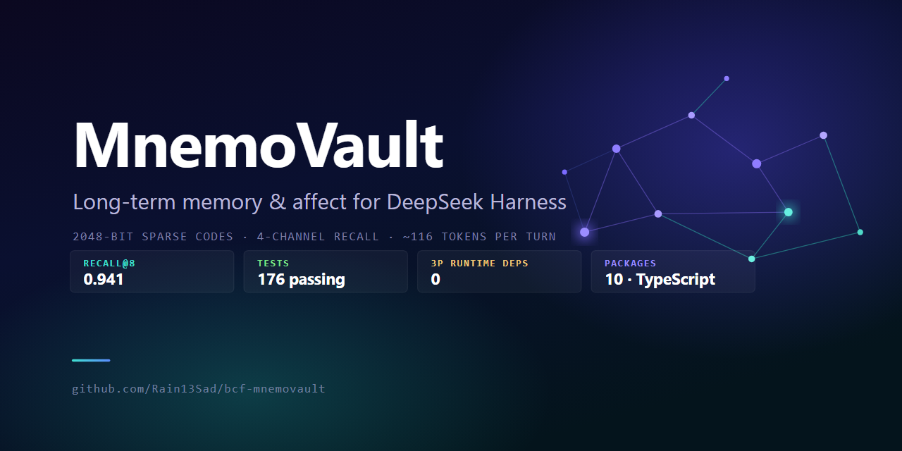
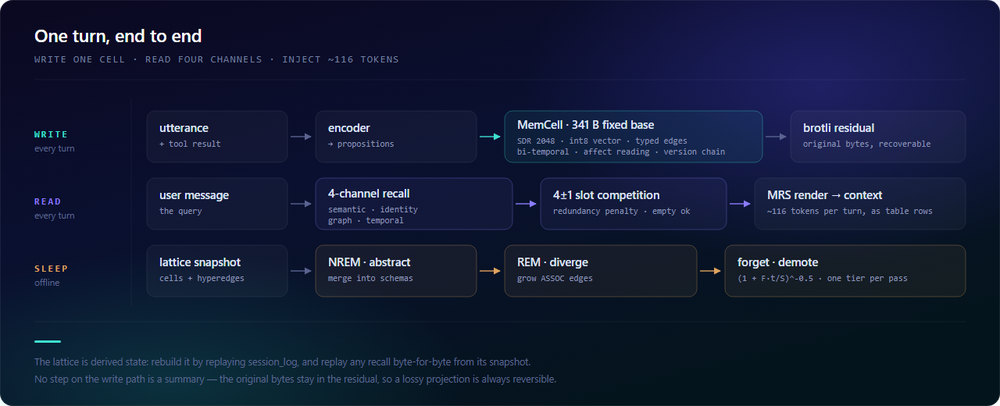

<!-- DOC-VERSION: 0.5.2 -->

# MnemoVault

<div align="center">
  
</div>

<div align="center">

**Memoria a largo plazo y afecto para DeepSeek Harness.**
Las memorias no se guardan como texto sino como **celdas de tamaño fijo** (código disperso + vector int8 +
hiperaristas tipadas + residuo comprimido). La inyección ronda los **116 tokens por turno** en lugar de
repetir la transcripción.

[](https://github.com/Rain13Sad/bcf-mnemovault/actions/workflows/ci.yml)
[](https://www.npmjs.com/package/@rain13sad/dsh-mnemo-core)
[](LICENSE)
[](#inicio-rápido)
[](test/)

[English](README.md) · [简体中文](README.zh-CN.md) · [日本語](README.ja.md) · [한국어](README.ko.md) · **Español**

</div>

> **Esta página es un resumen.** La documentación canónica está en el
> [README en inglés](README.md) y en el [README en chino](README.zh-CN.md): allí están la cadena completa
> de decisión de borrado, los cambios de v0.5.x y las 28 limitaciones conocidas (D1–D28).

| | |
| :--- | :--- |
| **Estado** | **v0.5.2** · Developer Preview (base DSH `0.2.1-rc.3`) |
| **Tamaño** | 10 paquetes · 59 archivos fuente / ~18.700 líneas (`.ts` + `.tsx`) · 176 pruebas |
| **Dependencias** | En ejecución **no depende de ningún paquete de terceros fuera de `@deepseek-ai/*`** (el único externo es `schemastery` para los esquemas de configuración; el resto es Node integrado: `node:sqlite` / `node:zlib`) |
| **Requisitos** | Node ≥ 22.13 · npm ≥ 10. Ejecutar las pruebas no requiere un host DSH |

---

## Acerca de

**Función.** Da al agente de DSH una memoria que dura más que la ventana de contexto. Cada turno se
escribe como una celda de tamaño fijo; cada respuesta lee de ella por cuatro canales e inyecta
**~116 tokens** en lugar de repetir la transcripción. Además de los hechos guarda un estado afectivo
(evaluación → PAD → ánimo → relación → ancla de persona), así que se recupera tanto *qué* se dijo como
*cómo* se dijo. 22 subcomandos, un panel de siete pestañas y una regla dura: olvidar es una decisión
legible, no un TTL invisible.

**Tecnología.** Aquí nada se guarda como texto. Una celda son 341 B: código disperso de 2048 bits
(identidad), vector int8 plegado a 128 dimensiones (semántica), hiperaristas tipadas (relaciones),
marcas temporales bi-temporales, lectura afectiva y cadena de versiones; los bytes originales quedan en
un residuo brotli, así que ningún paso es lossy para siempre. El almacenamiento es un único archivo
`node:sqlite`; la recuperación usa un índice invertido SDR y una matriz de vectores int8 contigua, de
modo que la ruta rápida puntúa bit a bit igual que la lenta. La retención es una tubería puntuable:
siete factores → envolvente de obsolescencia → cinco bandas puntuadas (P5…P1) → seis puertas que solo
pueden limitar el tier → cinco tiers, un escalón por pasada. **La recuperación nunca llama a un modelo.**

**Ventaja.** Como en la lectura no hay nada generativo, la recuperación es **determinista y reproducible
byte a byte** desde una instantánea. Como el residuo se conserva, «resumir y tirar el original» no
ocurre. Como el borrado se puntúa y se explica, la biblioteca puede encogerse sin perder en silencio que
algo ocurrió. Y el coste no crece: p50 **~4 ms** con 822 celdas, p95 **25–32 ms** con 10k celdas, cero
dependencias de terceros fuera de `@deepseek-ai/*`, 10 paquetes, 176 pruebas, solo módulos de Node.

## Qué resuelve

La ventana de contexto es finita: «lo que me contaste hace tres meses» no cabe, o sale demasiado caro.
La respuesta habitual es resumir la conversación y guardarla como texto, pero **un resumen es lossy e
irreproducible**.

Este proyecto toma otro camino.

1. **Escritura**: divide el enunciado en proposiciones y codifica cada una en una celda de tamaño fijo
   (código disperso + vector int8 + aristas tipadas + doble eje temporal + lectura afectiva + cadena de versiones).
   El texto original se conserva aparte como residuo brotli y siempre puede recuperarse.
2. **Lectura**: cuatro canales (semántico / identidad / grafo / temporal), fusión de puntuaciones y una
   competición de 4±1 ranuras que decide qué se inyecta.
3. **Offline**: NREM abstrae esquemas, REM crea asociaciones, y la **retención de siete factores**
   (activación ACT-R + importancia + afecto + conectividad + rol narrativo + anclaje del usuario + espaciado − redundancia)
   decide la jerarquía.

<div align="center">
  
</div>

## Novedades de v0.5.x

- **La decisión de borrado por fin actúa**: en v0.4, diez enunciados normales envejecidos 400 días producían
  **cero** degradaciones. Tres defectos se sumaban (una compuerta siempre verdadera, factores estáticos que no
  envejecían y un paso por pasada contra un suelo P3); v0.5 los separó.
- **La compuerta ya no reescribe la puntuación**: la calculan los siete factores; la compuerta solo impide
  llegar a lápida.
- **v0.5.2 — aguanta a escala real.** El cuello de botella no era "las escrituras son O(n)" sino
  **"cada recuperación decodificaba todos los blobs de la biblioteca para hacer 128 multiplicaciones"**.
  Con 822 celdas, un turno pasa de 25,4 ms a **3,1 ms** (la tendencia deja de crecer); con 10.000 celdas,
  el p95 de recuperación es **25 ms**. Incluye índice invertido SDR (umbrales derivados del criterio de
  Jaccard, así que los candidatos son un superconjunto), matriz de vectores en memoria, índice temporal,
  y retención persistida con poda por monotonía.
- **tier 4 = lápida**: libera el residuo y el vector, queda fuera de la recuperación y puede revivirse desde
  el panel (el texto original no vuelve).
- **v0.5.1**: corrige la pérdida de signo en i8 (valores afectivos negativos se leían positivos), la
  oscilación de la jerarquía por el bonus de aniversario y el interruptor muerto que hacía invisibles las lápidas.

## Inicio rápido

```bash
npm ci               # solo devDependencies (typescript / react / tipos)
npm run build        # compila los 10 paquetes en orden de dependencia (tsc, sin bundler)
npm test             # 160 pruebas
npm run demo         # diálogo chino de 26 turnos: inyección / consolidación / estadísticas / egress guard
npm run bench:eval   # Recall@8 / MRR / deduplicación / razonamiento temporal / coste en tokens
npm run panel        # vista previa del panel → http://127.0.0.1:5178/
```

Para instalarlo en DSH:

```bash
npm i @rain13sad/dsh-mnemo-core @rain13sad/dsh-mnemo-encoder @rain13sad/dsh-mnemo-recall @rain13sad/dsh-mnemo-tools
npm i @rain13sad/dsh-mnemo-affect @rain13sad/dsh-mnemo-consolidator @rain13sad/dsh-mnemo-proactive
npm i @rain13sad/dsh-mnemo-ui @rain13sad/dsh-mnemo-settings
```

Añade el `cordis.patch.yml` de cada paquete a tu perfil. La forma real de las costuras del host está
documentada en [`docs/API-CONTRACT.md`](docs/API-CONTRACT.md).

## Lo que no es

- **No sustituye a RAG.** Recupera memorias *sobre una persona*, no documentos.
- **No reclama conciencia fenoménica.** La salida afectiva es una proyección de variables de estado;
  `affect_report` devuelve números y su propio descargo de responsabilidad.
- **No es un producto listo para usar.** Necesita un host DSH, que sigue en Developer Preview.

## Para seguir leyendo

| Documento | Contenido |
| :--- | :--- |
| [`README.md`](README.md) | Versión inglesa (cadena de decisión, benchmarks, 19 limitaciones) |
| [`README.zh-CN.md`](README.zh-CN.md) | Versión china (la más detallada; referencia de términos y cifras) |
| [`docs/design/V0.5-PLAN.md`](docs/design/V0.5-PLAN.md) | Decisiones de diseño y medidas de v0.5 |
| [`docs/PROJECT-GUIDE.md`](docs/PROJECT-GUIDE.md) | 19 defectos (D1–D19) y propuestas de mejora |
| [`CONTRIBUTING.md`](CONTRIBUTING.md) | Entorno, mapa del código y restricciones |

## Licencia

MIT
