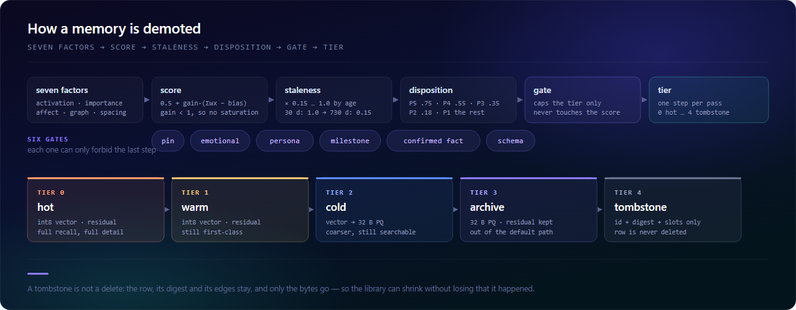

<!-- DOC-VERSION: 0.5.3 -->

# MnemoVault

<div align="center">
  
</div>

<div align="center">

**Long-term memory and affect for [DeepSeek Harness](https://www.npmjs.com/package/@deepseek-ai/dsh).**
Memories are stored as fixed-size cells — sparse codes, int8 vectors, typed hyperedges, compressed
residuals — not as text. Injection renders **~116 tokens per turn** instead of replaying the transcript.

[](https://github.com/Rain13Sad/bcf-mnemovault/actions/workflows/ci.yml)
[](https://www.npmjs.com/package/@rain13sad/dsh-mnemo-core)
[](LICENSE)
[](#requirements)
[](test/)
[](docs/API-CONTRACT.md)
[](CONTRIBUTING.md)

**English** · [简体中文](README.zh-CN.md) · [日本語](README.ja.md) · [한국어](README.ko.md) · [Español](README.es.md)

</div>

> Memory should not be text. Text is a projection for humans, not a storage format for machines.
>
> This README is the English summary. The **Chinese documentation is canonical** — it is where the
> design rationale, the 28 known weaknesses (D1–D28, [`PROJECT-GUIDE`](docs/PROJECT-GUIDE.md) §12)
> and the measured numbers live.

| | |
| :--- | :--- |
| **Status** | **v0.5.3** · Developer Preview. Baseline DSH `0.2.1-rc.3` (`next` channel); the host itself still ships breaking changes |
| **Size** | 10 packages · 60 source files / ~18,900 lines of TS (`.ts` + `.tsx`, UI included) · 184 tests · **no third-party runtime dependency outside `@deepseek-ai/*`** (the only external one is `schemastery` for config schemas; the rest is Node built-in: `node:sqlite` / `node:zlib`) |
| **Start here** | Maintaining it → [Project guide](docs/PROJECT-GUIDE.md) (in Chinese)<br>Hacking on it → [CONTRIBUTING](CONTRIBUTING.md)　Design rationale → [design doc v0.2](docs/design/MNEMOVAULT-DESIGN.md)<br>All docs → [docs/README.md](docs/README.md) |
| **Time budget** | *Just run it* → 5 min, [Quick start](#quick-start)　·　*Judge it for production* → 40 min, PROJECT-GUIDE §12 (28 weaknesses with evidence)　·　*Change its behaviour* → 60 min, CONTRIBUTING + [`retention.ts`](packages/core/src/retention.ts) |

---

## Table of contents

- [About](#about) · [What's new in 0.5.3](#whats-new-in-053) · [How deletion actually works](#how-deletion-actually-works)
- [Why this exists](#why-this-exists) · [What it is not](#what-it-is-not) · [Data flow](#data-flow)
- [Quick start](#quick-start) · [Five minutes to first call](#five-minutes-to-first-call) · [Benchmarks](#benchmarks)
- [Packages](#packages) · [Panel](#panel) · [How it compares](#how-it-compares)
- [Known limitations](#known-limitations) · [Documentation](#documentation)
- [Contributing](#contributing) · [License](#license)

---

## About

**Function.** MnemoVault gives a DeepSeek Harness agent a memory that outlives the context window.
Every turn is written as one fixed-size cell; every reply recalls from it in four channels and injects
**~116 tokens** instead of replaying the transcript. Beside facts it keeps an affect state —
appraisal → PAD → mood → relationship → persona anchor — so *how* something was said stays available,
not only *what* was said. 22 subcommands, a seven-tab panel, and a hard rule that forgetting is a
decision you can read, not a TTL you cannot.

**Technology.** Nothing here is stored as text. A cell is 341 B: a 2048-bit sparse code (identity), an
int8 vector folded to 128 dimensions (semantics), typed hyperedges (relations), bi-temporal timestamps,
an affect reading and a version chain — with the original bytes kept in a brotli residual, so no step is
lossy forever. Storage is one `node:sqlite` file; recall runs an SDR inverted index plus a contiguous
int8 vector matrix, so the fast path scores bit-identically to the slow one. Retention is a scored
pipeline: seven factors → staleness envelope → five scored bands (P5…P1) → six gates that can only cap
a tier → five tiers, one step per pass. **Retrieval never calls a model.**

**Advantage.** Because nothing on the read path is generative, recall is **deterministic and replayable
byte-for-byte** from a snapshot, and the same query on the same library always returns the same rows.
Because the residual is kept, "summarise it and drop the original" never happens. Because deletion is
scored and explained, the library can shrink without silently losing that something happened. And the
cost stays flat: recall p50 **~4 ms** at 822 cells, p95 **25–32 ms** at 10k cells, no third-party
runtime dependency outside `@deepseek-ai/*`, 10 packages, 184 tests, Node built-ins only.

---

## What's new in 0.5.3

**0.5.3 is the release where it can be installed.** 0.5.2 was published, green in CI, 176 tests passing —
and four of its ten packages could not be installed into DSH at all. Every one of those defects lived in
the gap between "the code is right" and "the host accepts it", which is exactly the gap no unit test
was watching.

The first symptom is the one in the issue tracker:

> 这个包没有声明组合包，不能作为插件管理
> *(this package declares no bundle, so it cannot be managed as a plugin)*

| What was wrong | Why it was invisible | Fix |
| :--- | :--- | :--- |
| `ui` declared `dsh.client` but **no `dsh.bundle`** | Its `lib/index.js` exported constants, not a Cordis plugin, so nobody thought of it as a bundle | Real no-op host half (`apply` + `inject`) + `dsh.bundle` + a patch that inserts its own row |
| `devkit`, `proactive`, `ui` declared `dsh.bundle.patch` pointing at **files that did not exist** | `files[]` lists them, so publishing was clean; the loader only discovers the ENOENT at load time and **skips the whole layer** | `proactive` got its patch; `devkit` stopped pretending to be a plugin (it is a library) |
| `core`'s patch used `!!js` template expressions | Bundle patches are parsed by a **tag-less YAML parser** during install → `YAMLException` → the whole install is rolled back | Paths are resolved in `apply()` instead; patches carry literals only |
| `dbPath: ~/.dsh/mnemo/vault.db` and `!!js ${ctx.baseDir}` | `~` was **never expanded**, and `ctx.baseDir` does not exist on the Loader (it is `baseUrl`) — so the vault landed in a directory literally named `~` or `undefined` | `packages/core/src/paths.ts`: expand `~`, resolve relative paths against the profile dir |
| `exports["./client"]` pointed at `lib/client.js`, which **was never generated** — and the host only serves one file, in `window.__ModuleLoader__.load({...})` form | The preview, the SSR test and the bundle test all import `lib/client/Panel.js` directly, so they exercised a different path than the host | `scripts/client-build.mjs` folds the tsc output into a real module-loader bundle (no bundler dependency — see below) |

That last row is the one worth dwelling on: **the panel had never been rendered inside DSH.** It worked in
`npm run panel` because that pipeline copies the compiled ESM modules and serves them over HTTP with a
React shim; the host instead serves a single `client.js` that must call `__ModuleLoader__.load()` and take
React from a `require`-shaped module table. Two different contracts, one of them never tested.

### Install path, end to end

```bash
# one command, nine bundles — every package becomes a direct dependency, so the
# profile's reconciliation enables all of them
dsh plugin add \
  @rain13sad/dsh-mnemo-core @rain13sad/dsh-mnemo-affect @rain13sad/dsh-mnemo-encoder \
  @rain13sad/dsh-mnemo-recall @rain13sad/dsh-mnemo-consolidator @rain13sad/dsh-mnemo-proactive \
  @rain13sad/dsh-mnemo-tools @rain13sad/dsh-mnemo-settings @rain13sad/dsh-mnemo-ui
```

or pick one from the plugin manager — each package is independently installable and removable.
`dsh plugin add @rain13sad/dsh-mnemo-ui` alone also pulls `tools → core + affect`, because a panel with
no vault behind it is not a feature.

### New gates (so this cannot happen twice)

- **`npm run check:manifests`** — bundle/patch/client/row-ownership consistency: declared patch files must
  exist and be published, `dsh.bundle` packages must actually export `apply`, patches must not contain
  `!!js` or tabs, every inserted row must belong to the package or one of its dependencies, and no two
  packages may insert the same row id. Runs in `verify` and in both CI jobs.
- **`test/client-bundle.test.mjs`** — executes the real `lib/client.js` under a fake kernel that offers
  only `window.__ModuleLoader__` and `require`, then asserts `apply` registers the main panel and the
  sidebar entry.
- **`test/paths.test.mjs`** — `~` expansion, `:memory:` passthrough, and the `baseDir`/`baseUrl` trap.

### Panel

A degraded-state banner now appears whenever the data source is not the host's remote face: it says
whether you are looking at demo fixtures, a read-only event stream, or a panel with no vault behind it —
and what to enable. Previously all three looked identical: a screen full of zeros.

---

## What's new in 0.5.2

0.5.0 made the decision chain fire. 0.5.1 made it compute correctly. **0.5.2 makes it hold at scale** —
and it turned out the bottleneck was not where the audit said it was.

The audit fitted three points (200/400/800 turns → 3.24/4.76/9.45 ms per turn) and concluded
"writes are O(n), so extrapolate to 6.4 hours for 100k cells". Writes *were* O(n). But profiling the
whole turn showed a bigger, dumber cost: **to compute 128 multiply-adds, every recall decoded every
MC03 blob in the library.** Decoding dominated by two orders of magnitude.

| Before (0.5.1) | Now (0.5.2) | Measured |
| :--- | :--- | ---: |
| Q1 decoded the whole library to run `cosine` | **In-memory vector matrix** (contiguous `Int8Array`, cold PQ vectors expanded on insert with the *same* `expandEmb`, so scores are bit-identical) | recall p50 @822: 18 → **4 ms** |
| Dedupe and conflict detection each scanned every cell | **SDR inverted index** — thresholds derived from the Jaccard/containment gate (`o = J(|a|+\|b\|)/(1+J)`), so candidates are a **superset**, not an approximation | ingest @822: 46 → **1.8 ms** |
| `findConflict` bucketed by `agent|pred` — which is 1/6 of the library | Bucketed by `agent|pred|manner|patient|polarity`; same-patient only needs *opposite* polarity | `getCell` per 5 turns: 2026 → **16** |
| Q4 scanned the whole table although `idx_time` had existed since v0.2 | SQL range query | same results, verified against full scan |
| `stats()` decoded the library to count rows | SQL `GROUP BY` | @10k: 20 → **0.8 ms** |
| `doctor()` ran three full decodes per panel refresh | One merged pass + 30 s cache | @10k: ~700 → **~250 ms** |
| `demoteDue` recomputed all seven factors every tick, one WAL commit per cell | Retention **persisted** (`retention` table, no `cells` change), incremental sweep, monotonic pruning, **one transaction** | 10k pass: 2066 → **658 ms** |
| Consolidation held one transaction for the whole pass | Committed per phase | lock per phase, not per pass |
| README's "10k cells, p95 ≤ 40 ms" was never asserted anywhere | `ci-assert-scale.mjs` in CI | **25 ms** |

The trend matters more than any single number — **it stopped growing**:

```text
turn ms (real ingest)     222 cells 4.0   ·   422 cells 2.8   ·   822 cells 3.1
steady ingest ms          222 cells 2.1   ·   422 cells 2.1   ·   822 cells 1.8
recall p50 ms             222 cells 4     ·   422 cells 4     ·   822 cells 4
```

Plus nine deterministic fixes that the audit found by reading the source (all real, all now tested):

| # | Bug | Fix |
| :--- | :--- | :--- |
| D20 | `explain()` ran a **non-readOnly** recall, so `/mnemo why` raised the target's `tAccess` | `readOnly: true` — observation must not mutate what is observed |
| D21 | Schema cells were written with `flags: FLAG.noDecay & 0` (always 0), so schemas were decayed like ordinary episodes | `FLAG.noDecay`; schemas now hold P5 |
| D22 | `maxResidualBytes` truncated by UTF-16 code unit, so "8192" stored ~24 KB of Chinese | truncate by UTF-8 bytes on code-point boundaries |
| D23 | Two copies of short-id resolution, both **silently taking the first match** — on an irreversible `forget --hard` | merged into `tools/src/id.ts`; >1 match throws `AmbiguousCellIdError` |
| D24 | Retention was never persisted | see the table above |
| D25 | Main benchmark used `MemoryStore`; scale bench was not in CI | scale gate + explicit "MemoryStore, not SQLite" banner |
| D26 | Two drivers disagree on residual refcount semantics | **not fixed** — small blast radius, needs a semantics decision (documented) |
| D27 | Write path used `conn.prepare()` instead of the statement cache | all write paths go through `prep()` |
| D28 | Docs drifted: command count (15 stated, 22 real), `trace` documented but not implemented, byte size wrong | `check-readme` now verifies **command count** and **command existence**; `trace` implemented; 342 B measured |

Two bugs were caught *by the new tests while writing them*, which is the honest way to report them:

- the inverted index returned `overlap: threshold` instead of the true overlap, so Jaccard was
  under-computed and **dedupe silently stopped merging** (test: "same sentence twice → one cell");
- the index rebuild path forgot to carry `kind`, so after any external write every candidate looked
  like `kind 0` and the next ingest created a duplicate (test: "index self-heals after external write").

<details>
<summary>What 0.5.1 fixed (sign loss, anniversary oscillation, dead switch)</summary>

- **i8 sign lost on the `Uint8Array` boundary** — every negative valence/arousal/dominance read back positive
  (`-0.54` → `+1.48`). Fixed with `& 0xff` on write and sign-extending decode; **no rebuild needed**.
- **Anniversary boost broke monotonicity** — it was added after the staleness envelope and was wider than a
  band, so a compacted tombstone got promoted back to archive. Now capped at the current band's ceiling.
- **`includeTombstones` was a dead switch** — compaction drops `emb`, so the semantic channel scored 0.
  Added a catalogue channel over `digest` tokens.
- **`demoteDue` could promote** — now downward only.
- **Test clock never reached the service** — `createHarness({ now })` silently tested nothing.
- **PAD not clamped at encode.**

</details>

<details>
<summary>What 0.5.0 fixed (the decision chain was inert)</summary>

Ten ordinary user statements, aged 400 days, produced **zero** demotions: an always-true gate
(`trust >= 240` *is* `TRUST_BY_PROVENANCE[0]`) that also rewrote the score; six of seven factors static;
one-tier-per-pass colliding with a P3 floor. 0.5.0 replaced the gate with a **tier cap**, added the
staleness envelope, wired `tInvalid` in, fixed the `SUPERSEDES` direction, made `tier 4` a real
tombstone, and decoupled `confidence` from retrieval count.

</details>

---

## How deletion actually works

Most "agent memory" systems either never forget or forget by TTL. This one decides, and the decision is
readable end to end:

<div align="center">
  
</div>

The same chain, spelled out — every arrow below is a line of code in
[`retention.ts`](packages/core/src/retention.ts) and [`lifecycle.ts`](packages/core/src/lifecycle.ts):

```text
every cell
  ├─ FLAG.noDecay (pin / persona anchor) ────────────────→ never evaluated
  ├─ accessed < 30 min ago ─────────────────────────────→ still in working memory, skip
  │
  ▼
[seven factors] activation(ACT-R) · importance · affect · connectivity · narrative · affinity · spacing − redundancy
  │   score = 0.5 + gain·(Σwᵢxᵢ − bias)        gain < 1, or the top half saturates at 1.0
  ▼
[staleness envelope] × (0.15 + 0.85·clamp01(1 − (days−30)/700))
  │   30 days: no loss · 400 days: ≈0.55 · 730 days: floor
  ▼
[invalid?] tInvalid older than 30 days → force P2 / tier 3, gates off
  │
  ▼
[disposition] P5 ≥0.75 · P4 ≥0.55 · P3 ≥0.35 · P2 ≥0.18 · P1 <0.18
  │
  ▼
[gate] does NOT change the score — it only forbids the last step
  │   pin · emotional · persona · milestone · confirmed first-hand fact · schema
  ▼
[tier] 0 hot → 1 warm → 2 cold → 3 archive → 4 tombstone      (one step per pass)
  │
  ▼
[tombstone] release residual, drop vector, keep id + digest + slots
  │   excluded from recall · revivable from the panel · row is never deleted
  └── physical delete: `forget --hard --yes` only, with approval
```

Two properties are worth calling out because they are the ones people get wrong:

- **The gate cannot inflate a score.** In 0.4 it could, and because every user utterance carries
  `provenance = 0`, every user utterance was permanently warm. The panel shows both numbers:
  `score` (what the formula says) and `effective` (what actually happens), plus the reason.
- **A tombstone is not a delete.** The row, its digest, its slots and its edges stay; only the bytes go.
  That is what makes "the library can shrink" compatible with "you can still see that it happened".

---

## Why this exists

A context window is finite, and "what the user told you three months ago" either does not fit or is too
expensive to keep. The usual answer is to summarise the conversation into text and retrieve it — but
summaries are **lossy and irreproducible**: two runs over the same dialogue differ, and once you
summarise, the original is gone.

This project takes a different route:

1. **Write side** splits utterances into propositions and encodes each into a fixed-size cell:
   sparse code (identity) + int8 vector (semantics) + typed hyperedges (relations) + event/invalid
   timestamps (bi-temporal) + affect reading + version chain. The original bytes are kept separately
   as a brotli residual and can always be recovered.
2. **Read side** runs four retrieval channels (semantic / identity / graph / temporal), merges their
   scores, and lets a 4±1 slot competition decide what gets injected — rendered as table rows.
3. **Offline** consolidation is sleep-like and biphasic: NREM abstracts schemas, REM grows associations,
   a power-law forgetting curve demotes cells.
4. **Affect is a parameter, not a script**: appraisal → PAD → mood → relationship → persona anchor,
   all persisted as ordinary cells — evolvable and rollback-able.

## What it is not

- **Not a RAG replacement.** It retrieves memories *about a person*, not documents.
- **No claim of phenomenal consciousness.** Every affect output is a projection of state variables;
  `affect_report` returns numbers and ships its own disclaimer.
- **Not a turnkey product.** It needs a DSH host, and DSH is still in Developer Preview
  (supported range: `>=0.2.1-rc.3 <0.3.0`).
- **Extraction quality is rule-bound.** The L1 (model-based) port exists but only the rule-enhanced
  path runs today. A stated weakness, not a hidden one.

## Data flow

<div align="center">
  
</div>

The lattice is derived state: it can be rebuilt by replaying `session_log`, and any recall can be
replayed byte-for-byte from its snapshot.

---

## Quick start

<a id="requirements"></a>
**Requirements:** Node ≥ 22.13 (built-in `node:sqlite` / `node:zlib`) and npm ≥ 10.
**Running the tests does not require DSH.**

```bash
npm ci               # devDependencies only (typescript / react / types)
npm run build        # compiles the 10 packages in dependency order (plain tsc, no bundler)
npm test             # 184 tests
npm run demo         # 26-turn Chinese dialogue: injection / consolidation / stats / egress guard
npm run bench:eval   # mnemo-bench: Recall@8 / MRR / dedupe P,R / temporal reasoning / token cost
npm run panel        # panel preview at http://127.0.0.1:5178/  (#retention,wide for the desktop layout)
npm run verify       # all of the above in one shot (this is what CI runs)
```

### Installing into DSH

Published on npm as `@rain13sad/*` (public). **Every package is a self-contained DSH bundle**: it carries
a `cordis.patch.yml`, so `dsh plugin add` both installs it and turns it on. Do not hand-edit the profile.

Full stack — one command:

```bash
dsh plugin add \
  @rain13sad/dsh-mnemo-core @rain13sad/dsh-mnemo-affect @rain13sad/dsh-mnemo-encoder \
  @rain13sad/dsh-mnemo-recall @rain13sad/dsh-mnemo-consolidator @rain13sad/dsh-mnemo-proactive \
  @rain13sad/dsh-mnemo-tools @rain13sad/dsh-mnemo-settings @rain13sad/dsh-mnemo-ui
```

Or pick a slice — memory without affect is `core + encoder + recall + tools`:

```bash
dsh plugin add @rain13sad/dsh-mnemo-core @rain13sad/dsh-mnemo-encoder \
               @rain13sad/dsh-mnemo-recall @rain13sad/dsh-mnemo-tools
dsh plugin add @rain13sad/dsh-mnemo-ui       # panel; also pulls tools → core + affect
```

Then restart DSH. `dsh --profile <name> --dump-config | grep mnemo` shows the composed rows — that is the
quickest way to confirm a bundle is actually mounted instead of silently skipped.

**What each package inserts**

| Package | Row id | What it adds |
| :--- | :--- | :--- |
| `dsh-mnemo-core` | `mnemo-core` | the lattice service (`ctx.memory`), vault, four-channel recall |
| `dsh-mnemo-affect` | `mnemo-affect` | interoception → appraisal → PAD → mood → relationship model |
| `dsh-mnemo-encoder` | `mnemo-encoder` | write side: turn/end → 0..N `MemCell` |
| `dsh-mnemo-recall` | `mnemo-recall` | read side: `agent/pre-step` gating + injection |
| `dsh-mnemo-consolidator` | `mnemo-consolidator` | offline NREM/REM pass, decay, pruning |
| `dsh-mnemo-proactive` | `mnemo-proactive` | decides *whether* to speak first (and mostly decides not to) |
| `dsh-mnemo-tools` | `mnemo-tools` | 6 tools + `/mnemo` commands + egress guard + the panel's data bridge |
| `dsh-mnemo-settings` | `mnemo-settings` | presets, effect matrix, config snapshot |
| `dsh-mnemo-ui` | `mnemo-ui` | sidebar panel (client half lives in `lib/client.js`) |
| `dsh-mnemo-devkit` | — | **not a bundle**: a host-free harness (`createHarness`) for tests and demos |

The actual shape of the host-side seams — and where it differs from the design doc — is recorded in
[`docs/API-CONTRACT.md`](docs/API-CONTRACT.md). If an install is rejected, `npm run check:manifests`
in the checkout tells you which contract the package violates.

<details>
<summary>Working from source instead</summary>

```bash
git clone https://github.com/Rain13Sad/bcf-mnemovault.git
cd bcf-mnemovault
npm ci && npm run build
```

</details>

---

## Five minutes to first call

You do **not** need a DSH host to run it. The harness boots the real Cordis plugins with stub session/tool
services, so what you see here is the same code path the host uses.

```ts
import { createHarness } from '@rain13sad/dsh-mnemo-devkit'

const h = await createHarness({ sessionId: 'hello' })

await h.turn('我叫阿哲，负责前端。我们用 pnpm 构建。')
await h.turn('构建工具后来换成了 bun。')

const r = h.memory.recall({ text: '现在用什么构建', budget: 400 })
console.log(r.rendered)
// [MEM v2] 每行一条记忆，字段以 | 分隔。
// M:5c24|T:1030|P:u|F:fact|K:构建=bun|V:0|S:0.77|C:0.81
console.log(r.tokens, r.strategy, r.slotsUsed)   // 91 'semantic' 1

console.log(h.memory.explain(r.hits[0].cellId))
// cell 5c24  总分 0.65（阈值 0.42，槽位 1）
//   sim      1.00 × 1.00 =  1.00
//   recency  1.00 × 0.35 =  0.35
//   …

await h.dispose()
```

That single rendered row is the whole point: time, provenance, frame type, key/value, valence, salience
and confidence compressed into one line — 91 tokens instead of replaying two turns of transcript.

<details>
<summary>Using <code>MemoryService</code> directly (no harness)</summary>

```ts
import { Context } from '@deepseek-ai/cordis'
import { MemoryService, defaultConfig } from '@rain13sad/dsh-mnemo-core'

const ctx = new Context()
const mnemo = new MemoryService(ctx, { config: defaultConfig({ dbPath: 'vault.db' }) })
const dispose = mnemo.open()          // idempotent; returns a reverse-order disposer

// RecallQuery has no `k` — the budget is in **tokens**, not rows, and it is required.
const r = mnemo.recall({ text: '构建工具用的是什么', budget: 900, readOnly: true })
//                                     readOnly: panel / doctor / explainer must use it,
//                                     otherwise "one read" becomes "one use" and pins the memory warm

console.log(r.rendered, r.tokens, r.strategy, r.slotsUsed)
console.log(mnemo.explain(r.hits[0]?.cellId ?? ''))   // score + channel + reasons

dispose()
```

Writing goes through `ingest(cell)` — a `MemCell` is a fixed-size record, not a string. The encoder builds
them for you; `createHarness` above is the shortest path to see one.

</details>

---

## Benchmarks

Measured on Node 22.22 / Windows; reproducible from `artifacts/bench.json` (`npm run bench:eval`).

| Metric | Measured | Target | Note |
| :--- | ---: | :--- | :--- |
| Recall@8 | **0.941** | ≥ 0.80 | 34 synthetic facts with ground truth |
| MRR | **0.681** | ≥ 0.65 | same |
| Dedupe precision | **0.90** | ≥ 0.90 | restating a fact should merge |
| Dedupe recall | **1.00** | — | same topic, different value should not merge |
| Temporal reasoning | **1.00** | ≥ 0.75 | `pnpm → npm → bun` across three versions |
| tokens / turn | **106.4** | ≤ 240 | legend amortised |
| Recall p95 | **15 ms** | ≤ 40 ms @1M | 42 cells locally, not a million |
| Bytes per cell | **342 B** | — | MC03: 112 B header + sparse SDR + 128-dim vector (844 B in v0.2) |
| Storage ratio (short config-style DB) | 5.32× | diagnostic only | ~98 B turns (“我用 pnpm。”) — the fixed 342 B per cell dominates |
| Storage ratio (800-char turn, default split) | **0.839×** | ≤ 0.90 | 762 chars/turn, 2.25 cells/turn |
| Storage ratio (800-char turn, one cell) | **0.678×** | ≤ 0.72 | coarse control, shows split-granularity sensitivity |

**Size and latency are a trade — read both numbers.** MC03 cut a cell from 844 B to 341 B at the
cost of a more expensive decode (sparse delta-varint SDR, `encodeCell` +29%). Size is a persistent
cost, latency is paid on every recall, so v0.3.1 also removed three storage-layer constant factors
(cached prepared statements, single-query streaming traversal, single-pass `getCell`) and the
"rebuild the whole panel snapshot on every recall" waste — recall p50 at 500 cells went from 90 ms
back to 26 ms. Reporting only one of the two numbers would be telling half the story.

### At scale

The table above measures **quality** on a 300-turn corpus. Scale is a different question, so it gets a
different script, a different corpus and — importantly — a different claim:

| Cells | recall p50 | recall p95 | steady ingest p50 | index build | index memory |
| ---: | ---: | ---: | ---: | ---: | ---: |
| 222 | 4 ms | 9 ms | 2.1 ms | 10 ms | 72 KB |
| 422 | 4 ms | 7 ms | 2.1 ms | 12 ms | 137 KB |
| 822 | 4 ms | 7 ms | 1.8 ms | 20 ms | 266 KB |
| 10,000 | 20 ms | **25 ms** | 10 ms | 287 ms | 1.6 MB |

Index on vs off, same 10k corpus: **recall 11× faster, ingest 21× faster**
(`node scripts/bench-scale.mjs --corpus 10000 --ab`).

Latency on a shared machine is noisy: p95 for the 10k row measures **25–32 ms across runs**
(the 25 ms above is a quiet run). The CI gate is 40 ms, so it is asserted with headroom.

> **This corpus is synthetic, and the number is only about latency.** It is built by batch `putCell`
> plus synthetic edges — no residuals, uniform access history. Recall on it is **not comparable** to a
> real vault. The `caveat` field in `artifacts/bench-scale.json` says so, and so does the console output,
> because the failure mode here is a future reader quoting it as if it were real (that is D13's path).

CI turns these into failing assertions via [`scripts/ci-assert-bench.mjs`](scripts/ci-assert-bench.mjs)
(Recall@8 ≥ 0.80 / MRR ≥ 0.60 / tokens ≤ 240 / both storage profiles). Since v0.3 the storage ratio
**is gated** — but against the measured, reachable target, not the arithmetically impossible 0.60.
Scale is gated separately by [`scripts/ci-assert-scale.mjs`](scripts/ci-assert-scale.mjs):
10k cells, `recall p95 ≤ 40 ms`, index build ≤ 3 s, index memory ≤ 4 MB.

<details>
<summary><b>Why 0.45–0.60× was unreachable, and what v0.3 actually fixed</b></summary>

Two measurement errors came first, and they were the bulk of the 2.50×:

1. **The denominator was off by 2.7×.** The script claimed an "800-char turn" but built a 311-char
   (≈885 B) one, while the 0.45–0.60× estimate assumed ≈2.4 KB per turn. Fixed to 762 chars / 2072 B,
   and the fixture no longer repeats identical sentences (verbatim repeats compress to 0.10 and
   produce a number that only holds inside the fixture).
2. **The numerator mixed residuals into cells.** `bytesPerCell` divided total bytes by cell count,
   reporting 824 B when a cell is really 341 B.

Then three real encodings were replaced (704 B → 341 B per cell): 192 → 112 B header, 256 B SDR bitmap
→ sparse delta-varint indices, 256-dim int8 vector → 128-dim folded. Cold-tier PQ is now normalised
before 4-bit quantisation (it used to round every nibble to zero, making cold memories unretrievable).
Persona/relational cells are upserted instead of appended per revision.

The arithmetic that remains:

```text
ratio = residual compression + (nCells × 341) / L ≈ 0.47 + (n × 341) / 2072
```

Residual compression (0.47) is a hard floor. At 2.25 cells/turn → 0.84; at 1.25 → 0.68; the theoretical
single-cell limit is 0.63. **0.45–0.60× only holds below one cell per turn**, i.e. by giving up
proposition-level splitting. The doc put two contradictory requirements into one number; v0.3 replaces
it with the derived targets above and keeps `storageBreakEvenChars = 1443` — "below ~1.4 KB per turn,
structured memory costs more than the raw text" — which is the number users actually need.

</details>

---

## v0.3.1: fixing what v0.3.0 broke

v0.3.0 shipped a real improvement (storage ratio below 1.0 for the first time) but **could not be
installed**: `npm ci` failed and `npm install` produced compile errors. Ten packages were bumped to
0.3.0 while eight `package.json` files still declared `^0.2.0` for their siblings — and `^0.2.0`
excludes 0.3.0 in semver. Eight string replacements took the whole release down, which says the
missing piece was a **gate**, not a skill.

v0.3.1 fixes that, then works through two external audits:

| Area | What changed |
| :--- | :--- |
| Release | sibling deps → `^0.3.1`, regenerated lockfile, verified `npm ci && build` in a clean tree, new `ci-check-publish.mjs` gate, `engines.node` → 22.13 |
| Privacy (P0) | redaction now covers entities / slots / embeddings / topic / digest / **shadow log**; 7 → 11 PII classes; slot-level fallback |
| Deletion (P0) | `forget(hard)` releases the residual when no cell references it any more; `doctor` reports and purges orphan residuals |
| Approval | hard delete always asks; refuses outright with no approval surface; `mnemo_command` refuses `forget --hard` |
| Egress | guard is allowlist-based fail-closed (`webSearch` / `execute_shell` / `send_email` no longer slip through) |
| XSS | the explain panel no longer builds HTML strings |
| Read-side effects | opening the panel no longer wipes the proactive daily quota (v0.3 only fixed the test) |
| Reproducibility | seq off-by-one, three `Math.random` call sites, 32-bit edge prefix collisions, empty `snapshotId` |
| Performance | statement cache, streaming traversal, single-pass reads, `busy_timeout`, panel snapshot throttling |
| Panel | unified type scale and spacing, re-tuned dark palette, tag cloud from structured slots only, narrow-sidebar layout |

Tests 109 → 115. `npm run verify` green. `storageRatioRealistic` unchanged at 0.839.

---

## Packages

| Package | Role | Status | Key exports |
| :--- | :--- | :--- | :--- |
| [`…-core`](https://www.npmjs.com/package/@rain13sad/dsh-mnemo-core) | lattice + storage + recall + retention | **Preview** — API will move | `ctx.memory`, `SdrSpace`, `encodeCell`, `evaluateRetention` |
| [`…-affect`](https://www.npmjs.com/package/@rain13sad/dsh-mnemo-affect) | affect kernel | Preview | `ctx.affect`, `appraise`, `derivePolicy`, `classifyEmotion` |
| [`…-encoder`](https://www.npmjs.com/package/@rain13sad/dsh-mnemo-encoder) | write side | Preview | `Encoder` (subscribes to `session/event`) |
| [`…-recall`](https://www.npmjs.com/package/@rain13sad/dsh-mnemo-recall) | read side | Preview | `agent/pre-step` gating and injection |
| [`…-consolidator`](https://www.npmjs.com/package/@rain13sad/dsh-mnemo-consolidator) | offline consolidation + sleep replay | Preview | `Consolidator` (NREM / REM / replay / forgetting) |
| [`…-tools`](https://www.npmjs.com/package/@rain13sad/dsh-mnemo-tools) | tools + commands | Stable-ish | 6 tools, 22 subcommands, egress guard |
| [`…-proactive`](https://www.npmjs.com/package/@rain13sad/dsh-mnemo-proactive) | speaking up first | Experimental | `ctx.mnemoProactive`, `candidate()`, `tick()` |
| [`…-settings`](https://www.npmjs.com/package/@rain13sad/dsh-mnemo-settings) | settings panel | Experimental | `ctx.mnemoSettings`, effect matrix |
| [`…-ui`](https://www.npmjs.com/package/@rain13sad/dsh-mnemo-ui) | panel (client, React) | Experimental — needs `react` | `main` + `sidebar.panellist` slot registration |
| [`…-devkit`](https://www.npmjs.com/package/@rain13sad/dsh-mnemo-devkit) | host-free harness | Testing utility | `createHarness()` (real Cordis fiber) |

The split is not cosmetic: Cordis `inject` is dependency-driven, so users who want memory without
affect install `core + encoder + recall + tools` only, and `recall` degrades to a no-affect gating path.

---

## Panel

The panel registers through the **actually published** client contract of `0.2.1-rc.3`:

```ts
export const inject = ['slots', 'layout']
ctx.slots.register({ name: 'main', key: 'mnemo' }, MnemoPanel)
ctx.slots.register({ name: 'sidebar.panellist', id: 'mnemo', order: 60, label: () => '记忆' }, PanelIcon)
```

### Desktop-first, but not desktop-only

The layout switches on the **panel's own width**, not the viewport — the same component may live in a
320 px sidebar or fill a 1440 px window. `@container (min-width: 760px)` turns the top tab strip into a
left rail and puts the content into two columns; below 760 px it degrades to the 0.3 layout.

<p align="center">
  
</p>

<p align="center">
  
</p>

<p align="center">
  
</p>

### Seven tabs

| Tab | Question it answers |
| :--- | :--- |
| **Overview** | Where is the store, what state is it in — path + actions, metrics, categories, index status, tag cloud, four recent columns, backend capabilities |
| **Search** | Is the memory I want in there — filters, per-hit channel and score, inline "why" from the same `ScoreBreakdown` |
| **Organize** | How to make it better — consolidation pass, association/version-chain stats, graph, invalidated versions |
| **Retention** | **Why is this still here / why is it almost gone** — six-disposition distribution, library growth (archive / tombstone / KB), seven-factor bars per memory, DA/ACh/NE/CORT signals, reconsolidation log, revive button on tombstones |
| **Inbox** | What is waiting on me — disputed or isolated single-evidence memories, contradiction adjudication |
| **Affect** | What state it is in — PAD scatter, six variables, OCC labels, episode state machine, persona anchor |
| **Settings** | How to tune it — preset/surface/ignition, real L1 and index shape, maintenance actions |

Counters live in the header/rail, not inside a tab: "how many are waiting on me" is a decision input.
Backend capabilities are runtime facts written by the host into `RuntimeStatus` — whether L1 uses a model
port or rule-based lite, whether the semantic channel is HNSW or exact scan, where the command surface
landed — so the panel can never claim a capability the host is silently degrading.

"Why was this recalled?" is rendered from the same `ScoreBreakdown` the scorer produces; host and client
implementations are cross-checked by `test/panel-ssr.test.mjs`.

---

## How it compares

| | MnemoVault | Mem0 | Zep / Graphiti | Letta (MemGPT) |
| :--- | :--- | :--- | :--- | :--- |
| Storage format | fixed-size binary cells (sparse code + int8 + hyperedges) | text + vectors | graph nodes + vectors | text blocks |
| Bi-temporal | event time **and** transaction time | no | yes | no |
| Forgetting | seven-factor retention, six dispositions, never auto-deletes | TTL / none | none | manual |
| Reconsolidation | yes — retrieval rewrites confidence and valence | no | no | no |
| Emotion as state | appraisal → PAD → mood → relationship → persona, all persisted | no | no | no |
| Runtime dependencies | **zero** (`node:sqlite` + `node:zlib`) | vector DB + LLM | Neo4j + LLM | Postgres + LLM |
| Cost model | ~116 tokens injected per turn | LLM call per write | LLM call per write | LLM call per turn |

The trade-off is deliberate: MnemoVault does **not** call an LLM to decide what to remember. Extraction is
rule-based and deterministic, which is why the same dialogue replays to the same lattice.

---

## Known limitations

The full catalogue is **28 known weaknesses (D1–D28)** in [`PROJECT-GUIDE` §12](docs/PROJECT-GUIDE.md),
each with evidence and a severity. Nine of them (D20–D28) were found by the v0.5.2 audit and are already
fixed — they are listed there because *they existed*, and because three of them were the silent kind.
Below are the 17 that still bite users in practice.

1. **Embeddings are not a semantic model.** Bigram backbone + 24 synonym families + whole-identifier
   tokens, but no word vectors and no context. Real semantics needs the host's embedding service
   (`EmbeddingPort` is defined, not wired).
2. **The L1 port is recognised but has never run against a real host.** Eight entry shapes plus a startup
   probe; the panel shows "lite rule split" until a probe passes.
3. **HNSW is implemented but off below 2000 cells** (exact scan is faster and has no approximation error).
   There is no million-cell benchmark — only overlap tests (≥0.85).
4. **`ctx.remote` is wired, but the host registry shape is unverified.** The panel falls back to the local service.
5. **The command surface probes four shapes** and only degrades to `mnemo_command` when none match.
6. **Writes are O(n).** `ingest` runs a full scan for dedupe and another for conflict detection: ~23 ms per
   write at 1000 cells. A SDR inverted index is the fix; it is not here yet.
7. **Retention is not materialised.** The seven-factor score is computed on read (last 120 cells for the
   panel, one full pass per demotion tick). At 10⁵ cells this needs a `retention_score` column.
8. **Tombstones are irreversible in content.** Compaction releases the residual, so reviving a tombstone
   gives you the digest and slots, not the original sentence. That is the trade that makes byte reclamation
   possible; the row and its lineage survive.
9. **The shadow log is a second copy.** `session_log` keeps the redacted transcript so the lattice can be
   rebuilt; `forget --hard` does not delete it (deleting it would make rebuild impossible). See [SECURITY.md](SECURITY.md).
10. **Storage ratio depends on how long your turns are.** ~0.84× on 300-character turns, but **~6× on short
    config-style sentences** ("我用 pnpm。") because the fixed per-cell cost dominates. Both numbers are in
    [Benchmarks](#benchmarks); the 0.45–0.60× figure in older docs was measured on neither.
11. **CA3 auto-association and STDP are still 0.3-era.** Pattern completion and synaptic homeostasis change
    edge-weight semantics and would invalidate the bench baseline; only the four neuromodulator signals shipped.
12. **Reconsolidation's prediction error is a proxy.** It fires when conflict detection reports a correction;
    there is no per-turn user feedback signal yet (`predictionErrorProxy` exists, unwired).
13. **The staleness envelope is a policy, not a law.** 30 / 700 / 0.15 are constants in `retention.ts`, not
    config — changing them changes what "old" means, so it should be a deliberate edit with a test.
14. **Sleep replay only rescues, it does not create.** It promotes cells that already score high; it cannot
    invent a memory the encoder never wrote.
15. **P2/P1 need time to appear.** A fresh vault is almost all P5 — that is data freshness, not a broken
    formula; the retention page says so explicitly.
16. **No encryption at rest.** The database holds real conversations. See [SECURITY.md](SECURITY.md).
17. **No phenomenal consciousness**, by design. Every affect output is a projection of state variables;
    `affect_report` returns numbers and ships its own disclaimer.

> **Upgrading from ≤ 0.2:** MC03 changed the on-disk layout; run `/mnemo rebuild --from-log` once.
> Upgrading from 0.4 → 0.5.x needs no rebuild (tier 4 uses the existing tier byte).

---

## Documentation

Long-form docs are in Chinese; the design doc and the project guide are the two that matter.

| Doc | What it is |
| :--- | :--- |
| [`docs/README.md`](docs/README.md) | Documentation map — pick by intent, not by order |
| [`docs/PROJECT-GUIDE.md`](docs/PROJECT-GUIDE.md) | What the code actually does; 28 weaknesses with evidence; 12 improvements ranked P0–P2 |
| [`docs/design/MNEMOVAULT-DESIGN.md`](docs/design/MNEMOVAULT-DESIGN.md) | Full derivation: sparse-code algebra, four-channel recall, MRS rendering, biphasic consolidation |
| [`docs/design/V0.5.2-PLAN.md`](docs/design/V0.5.2-PLAN.md) | 0.5.2: the nine defects, the scale work, and the measured numbers |
| [`docs/releases/v0.5.2.md`](docs/releases/v0.5.2.md) | Release note for 0.5.2 |
| [`docs/design/V0.5-PLAN.md`](docs/design/V0.5-PLAN.md) | 0.5.0: the eleven confirmed defects, the fixes, and the verification numbers |
| [`docs/design/V0.4-PLAN.md`](docs/design/V0.4-PLAN.md) | 0.4.0 scope: what was taken from the v0.4 proposal, what was deferred, and the formulas |
| [`docs/API-CONTRACT.md`](docs/API-CONTRACT.md) | Where the real DSH `0.2.1-rc.3` packages differ from the design doc |
| [`docs/releases/v0.5.0.md`](docs/releases/v0.5.0.md) | Release note for 0.5.0 |
| [`docs/releases/v0.4.0.md`](docs/releases/v0.4.0.md) | Release note for 0.4.0 |
| [`CONTRIBUTING.md`](CONTRIBUTING.md) | Environment, code map, hard constraints, commit style |
| [`CHANGELOG.md`](CHANGELOG.md) · [`SECURITY.md`](SECURITY.md) · [`docs/PUBLISH.md`](docs/PUBLISH.md) | History, threat model, release steps |

## Contributing

Three hard constraints first: **injection has a token budget**, **writes must be reproducible**,
**no runtime dependencies**. Behaviour changes need tests — this project has a class of bugs
(a merge that overwrites leaves the old cell behind, so one fact becomes two records) that neither
the type checker nor code review can catch.

## License

[MIT](LICENSE). The research reports and the design doc under `docs/design/` remain the property of
their authors; this implementation only reproduces their engineering conclusions.
