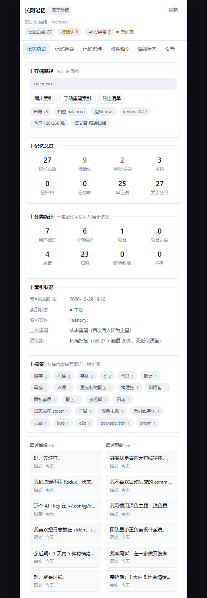
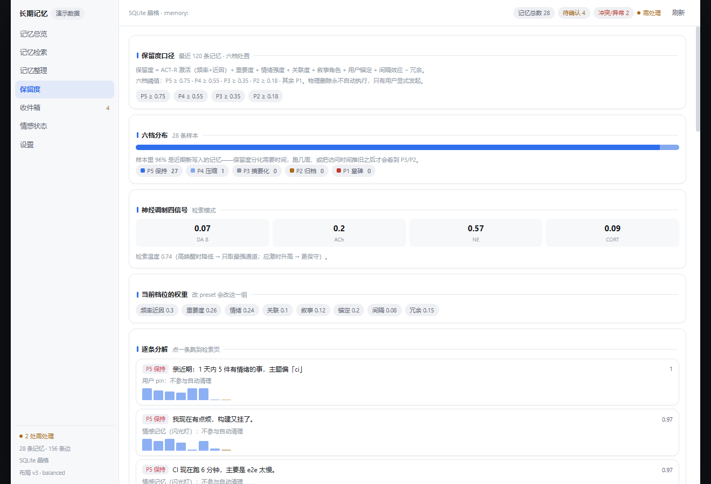
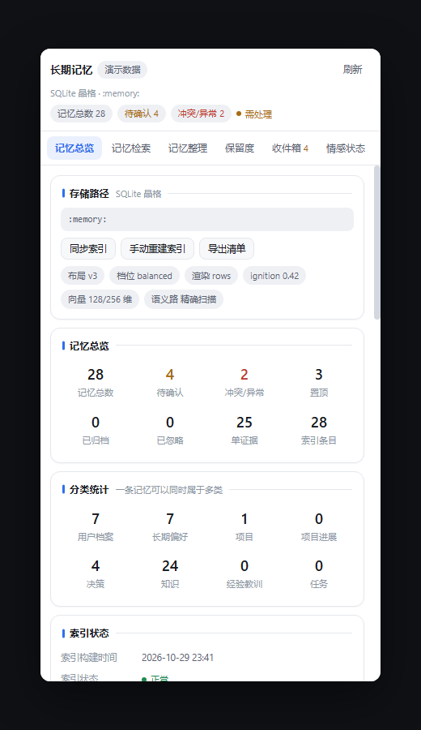

<div align="center">
  
</div>

<div align="center">

**给 DeepSeek Harness 用的长期记忆与情感插件包族。**
记忆不以文本存储：2048 位稀疏码 + int8 向量 + 有类型超边 + 压缩残差；
注入上下文时只渲染约 116 token，而不是把历史对话整段塞回去。

[](https://github.com/Rain13Sad/bcf-mnemovault/actions/workflows/ci.yml)
[](LICENSE)
[](#快速开始)
[](test/)
[](docs/API-CONTRACT.md)
[](CONTRIBUTING.md)

[English](README.md) · **简体中文** · [日本語](README.ja.md) · [한국어](README.ko.md) · [Español](README.es.md)

</div>

> **一句话**：记忆不该是文字。文字是给人看的投影，不是给机器存的格式。
> 本文是最详细的一版（其余语言为摘要）；术语与实测数字以本文为准。

| | |
| :--- | :--- |
| **状态** | **v0.5.0** · Developer Preview。基线 DSH `0.2.1-rc.3`（`next` 通道），宿主自身仍在破坏性变更中 |
| **规模** | 10 个包 · 46 个源文件 / 约 13,100 行 TS · 151 条测试 · **零运行时依赖**（只用内置 `node:sqlite` 与 `node:zlib`） |
| **先读哪份** | 接手维护 → [项目说明书](docs/PROJECT-GUIDE.md)（含 15 条缺点 / 12 条改进意见，已按 P0–P2 排序）<br>改代码 → [CONTRIBUTING](CONTRIBUTING.md)　算法依据 → [设计文档 v0.2](docs/design/MNEMOVAULT-DESIGN.md)<br>全部文档 → [docs/README.md](docs/README.md) |

---

## 它解决什么

DSH 的上下文窗口是有限的，而"用户三个月前说过什么"要么塞不进去、要么塞进去太贵。
常见做法是把对话摘要成文本再检索，但摘要是**有损且不可复现**的——同一段对话两次摘要不一样，
而且摘要之后原文就没了。

这里换一条路：

1. **写侧**把话语拆成命题，编码成定长晶胞：稀疏码（身份）+ int8 向量（语义）+ 有类型超边（关系）
   + 事件时间与失效时间（双时态）+ 情感读数 + 版本链。原文以 brotli 残差单独存，随时可取回。
2. **读侧**四路召回（语义 / 身份 / 图 / 时间）合并打分，用 4±1 槽位竞争决定注入哪几条，
   渲染成表格行——稳态约 116 token/轮，对"整段摘要"类做法省约 90%。
3. **离线**做双相巩固：NREM 抽象出图式、REM 发散出联想、按幂律遗忘曲线降层。
4. **情感**不是台词，是参数：评价 → PAD → 心境 → 关系 → 人格锚，全部落盘为普通 cell，可演化可回滚。

<div align="center">
  
</div>

## 它不解决什么

- **不是 RAG 替代品。** 不做文档检索，只做"关于这个人的记忆"。
- **不声称现象意识。** 所有情感输出都是状态变量的投影；`affect_report` 返回数值并自带免责声明。
- **不是开箱即用的产品。** 需要 DSH 宿主，而宿主仍是 Developer Preview；本项目对宿主版本的容忍区间是 `>=0.2.1-rc.3 <0.3.0`。
- **抽取质量受规则限制。** L1（模型抽取）端口已留但只跑了"规则增强"版，这是明确的已知短板，不是隐藏的。

---

## 快速开始

环境：**Node ≥ 22.5**（依赖内置 `node:sqlite` / `node:zlib`）、npm ≥ 10。跑测试**不需要**装 DSH。

```bash
npm ci               # 只有 devDependencies（typescript / react / 类型）
npm run build        # 按依赖顺序编译 10 个包（没有 bundler，逐包 tsc）
npm test             # 93 条测试
npm run demo         # 26 轮中文对话：注入 / 巩固 / 统计 / 守卫
npm run bench:eval   # mnemo-bench：Recall@8 / MRR / 去重 P,R / 时间推理 / 成本
npm run panel        # 面板预览：http://127.0.0.1:5178/
npm run verify       # 以上四件事一次跑完（CI 跑的就是它）
```

实测（Node 22.22 / Windows，`artifacts/bench.json` 可复现）：

| 指标 | 实测 | 目标 | 说明 |
| :--- | ---: | :--- | :--- |
| Recall@8 | **0.941** | ≥ 0.80 | 34 条合成事实、带 ground truth |
| MRR | **0.681** | ≥ 0.65 | 同上 |
| 去重精确率 | **0.90** | ≥ 0.90 | 同一事实重述应合并 |
| 去重召回率 | **1.00** | — | 同话题不同取值不应合并 |
| 时间推理准确率 | **1.00** | ≥ 0.75 | 三版 `pnpm→npm→bun` 的双时态查询 |
| tokens/轮 | **106.9** | ≤ 240 | 含图例摊薄 |
| 召回 p95 | **32 ms** | ≤ 40 ms @100 万 | 本机 100 cell 规模，非百万级 |
| 召回 p50（真实 SQLite，500 cell） | **26 ms** | — | `bench-scale.mjs`；v0.3 同口径为 90 ms |
| 召回 p50（真实 SQLite，1000 cell） | **43 ms** | — | 仍是 O(n)：去重与冲突检测各一次全扫 |
| `forEachCell`（2000 cell） | **34 ms** | — | v0.3 为 111 ms（N+1 点查） |
| 单条 cell 体积 | **341 B** | — | MC03：112 B 头 + 稀疏 SDR + 128 维向量（v0.2 为 844 B） |
| 存储比（短命题库） | 5.32× | 诊断口径 | 100 B 级轮次，定长基底主导，不代表真实轮次 |
| 存储比（800 字轮次，默认切分） | **0.84×** | ≤ 0.90 | 762 字/轮、2.25 条 cell/轮 |
| 存储比（800 字轮次，每轮 1 条） | **0.68×** | ≤ 0.72 | 粗粒度对照档，验证"切分粒度 → 存储比"的敏感度 |

**体积与延迟是一笔交易，两个数都要看。** MC03 把单条 cell 从 844 B 压到 341 B，
代价是 SDR 改成"稀疏索引 + 差分变长整数"后解码更贵（`encodeCell` +29%）。
体积是持久成本、延迟是每次都要付的成本，所以 v0.3.1 同时修了存储层的三个常数因子
（语句缓存、单查询流式遍历、单趟 `getCell`）与"每次召回都重建整份面板快照"的浪费，
把 500 cell 的召回 p50 从 90 ms 拉回 26 ms。上表因此同时列体积与延迟——
只报其中一个，等于只讲一半。

CI 用 [`scripts/ci-assert-bench.mjs`](scripts/ci-assert-bench.mjs) 把这些数字变成会失败的断言
（Recall@8 ≥ 0.80 / MRR ≥ 0.60 / tokens ≤ 240 / 两个存储比档位）。v0.3 起存储比**进门槛**了——
但它卡的是**实测可达**的目标，而不是文档里那个算术上到不了的 0.60（推导见下一节）。

`npm run check`（SDR 性质）与 `npm run bench`（算子微基准）：

```
无关 bundle(24) Jaccard = 0.046        （文档 §6.5：0.047）
Jaccard 命中 0.081 / containment 1.000 （文档：0.087 / 1.000）
汉明相似度(无关码) = 0.992              （v0.1 的 D-02 复现）

popcount 183 ns   jaccard 193 ns   containment 297 ns
```

### 装到 DSH 里

已发布到 npm（`@rain13sad/*`，public）。按需装切片——包之间是独立的，只要记忆不要情感就是
`core + encoder + recall + tools`：

```bash
npm i @rain13sad/dsh-mnemo-core @rain13sad/dsh-mnemo-encoder @rain13sad/dsh-mnemo-recall @rain13sad/dsh-mnemo-tools
npm i @rain13sad/dsh-mnemo-affect @rain13sad/dsh-mnemo-consolidator @rain13sad/dsh-mnemo-proactive   # 可选层
npm i @rain13sad/dsh-mnemo-ui @rain13sad/dsh-mnemo-settings                                          # 面板与设置
```

想从源码跑（改代码 / 跑 demo）：

```bash
git clone https://github.com/Rain13Sad/bcf-mnemovault.git && cd bcf-mnemovault
npm ci && npm run build
```

然后按各包的 `cordis.patch.yml` 把插件 insert 进你的 DSH profile。每个 patch 里写的是
插件 id、包名与默认配置，例如 `packages/core/cordis.patch.yml`：

```yaml
- insert:
    - id: mnemo-core
      name: '@rain13sad/dsh-mnemo-core'
      config:
        dbPath: !!js `${ctx.baseDir}/mnemo/vault.db`
        sdrDim: 2048
```

宿主侧接口的实际形状（与设计文档有出入的地方）见 [`docs/API-CONTRACT.md`](docs/API-CONTRACT.md)。

---

## v0.5.0：让决策链真的会出手

v0.4 把保留度的**骨架**搭好了，但它的决策链是**惰性**的：
10 条普通用户陈述、把访问时间推到 400 天前，`demoteDue` 移动 **0 条**。
三个缺陷叠在一起：

| 缺陷 | 表现 | v0.5 的修法 |
| :--- | :--- | :--- |
| **恒真闸** | `trust >= 240 && provenance === 0` 命中 10/10——因为 `TRUST_BY_PROVENANCE[0]` 本身就是 240；闸还用 `score = max(score, 0.55)` **改分**，把七因子整体架空 | 闸**不再改分，只封顶 tier**（不许进墓碑）；一手事实闸加 `support ≥ 3 ∨ accessCount ≥ 3` |
| **静态因子不随时间贬值** | 七个因子里六个是静态量，400 天旧陈述仍拿 0.73（P4） | **陈旧包络**：`score × (0.15 + 0.85·clamp01(1 − (days−30)/700))`。30 天不折损，730 天到地板 |
| **逐级降档 × 闸 floor** | 一次一级是对的；一次一级 + 保底 P3 = 永远停在冷层 | 闸改为封顶后，`1 → 2 → 3 → 4` 能走完 |

同批修掉的还有：

| 之前 | 现在 |
| :--- | :--- |
| `tInvalid` 在召回/合并/抽象三处被消费，**唯独决定生死的地方不看它**——被取代的"用 vitest"仍拿 P4（0.716），与新值（P5，0.750）几乎同权 | 失效超过 30 天宽限期 → 强制归档，闸失效；`doctor` 找出存量数据，`--fix` 批量迁移 |
| `SUPERSEDES` 边读反了方向：拿到"版本链保护"的是**新值** | 改读 `dst`（被取代者）；"版本链环节"这道闸直接删掉——被取代本来就是最强的降档理由 |
| P1 与 P2 都映射到 tier 3，"墓碑"只存在于文档里 | **tier 4 = 墓碑**：释放残差、丢弃向量、不参与召回、面板可复活 |
| 库只进不出 | 墓碑压实把最大的一块字节（残差 ≈ 存储的 47%）还回去，同时保留行、摘要与血缘 |
| 召回会抬高 `confidence`：20 次召回、零新证据，0.775 → 0.950 | 召回只加固稳定性；置信度只由**证据**推动 |
| `recall()` 会写库，面板每 3 秒刷新一次就算一次"使用" | 面板 / doctor / 解释器一律走 `readOnly` |
| URL token 脱敏依赖 `?` 锚点，而切分已经把 `?` 切掉了 | 脱敏提到切分**之前**，规则也接受行首/空白锚点 |
| lockfile 只锁了一个 esbuild 平台包（npm 10 过、npm 11 失败） | `esbuild` 从没用过——删掉；lockfile 平台中立；CI 加 `npm@latest` 矩阵与平台检查 |

另外补了 v0.4 路线图里两项**不需要新数据结构**的：**睡眠选择性重放**（巩固期把"分数仍高但掉到归档"的记忆抬回一级）
与 **Gross 情绪调节**（五策略选一条，附特质层投影）。

### 删除决策链（v0.5 之后的实际形态）

```
每条记忆
  ├─ FLAG.noDecay（pin / 人格锚）────────────→ 永不评估
  ├─ 30 分钟内访问过 ───────────────────────→ 还在工作记忆，跳过
  ▼
[七因子] 激活(ACT-R) · 重要度 · 情绪 · 关联 · 叙事 · 锚定 · 间隔 − 冗余
  │  score = 0.5 + gain·(Σwᵢxᵢ − bias)      gain < 1，否则上半段全饱和到 1.0
  ▼
[陈旧包络] × (0.15 + 0.85·clamp01(1 − (days−30)/700))
  ▼
[失效？] tInvalid 超过 30 天 → 强制 P2 / tier 3，闸不生效
  ▼
[分档] P5 ≥0.75 · P4 ≥0.55 · P3 ≥0.35 · P2 ≥0.18 · P1 <0.18
  ▼
[闸门] **不改分**，只禁止最后一步
  │  pin · 情感 · 人格锚 · 里程碑 · 被确证的一手事实 · 图式
  ▼
[tier] 0 热 → 1 温 → 2 冷 → 3 归档 → 4 墓碑    （一次 pass 走一级）
  ▼
[墓碑] 释放残差、丢弃向量，只留 id + 摘要 + 槽位
  │  不参与召回 · 面板可复活 · 行永不删除
  └── 物理删除：只有 `forget --hard --yes`（审批制）
```

两条最容易做错的性质：

- **闸不能抬分。** v0.4 里它能，而每条用户发言都是 `provenance=0`，于是每条用户发言都永远温热。
  现在面板同时显示 `score`（公式说什么）与 `effective`（实际怎么做），以及理由。
- **墓碑不是删除。** 行、摘要、槽位、边全都还在，只有字节被释放——"库能变小"与"你还看得见它发生过"因此可以并存。

---

## v0.4.0：把"遗忘"和"情绪"从形容词变成机制

0.3 有两个说不清的地方：**为什么这条该留、那条该走**，以及**为什么难过的事会被忘掉**。
它们不是实现细节问题，而是"没有机制"——判据只有最后访问时间，情绪事件只是一个带半衰期的数组。
0.4 换掉了这两处，并让每一处都能被测试断言。

### ① 遗忘：七因子保留度 + 六档处置

```
score = 0.5 + gain · ( Σ wᵢ·xᵢ − bias )
x = 激活(ACT-R) · 重要度 · 情绪强度 · 关联度 · 叙事角色 · 用户锚定 · 间隔效应 − 冗余
```

ACT-R 的 base-level activation `B = ln Σ (t_now − t_j)^(−0.5)` 把**频率与近因统一进一个量**，
它天然是幂律，与原来的 R(t) 形状一致，可以无缝替换。其余六项各自可解释、可单独关掉。

| 档 | 阈值 | 动作 |
| :--- | :--- | :--- |
| P5 保持 | ≥ 0.75 | 热层，完整向量 + 残差 |
| P4 压缩 | ≥ 0.55 | 温层，向量降为 PQ32 |
| P3 摘要化 | ≥ 0.35 | 冷层，只留槽位 + digest |
| P2 归档 | ≥ 0.18 | 归档层 |
| P1 墓碑 | < 0.18 | 只留 id + digest + 理由 |
| P0 物理删除 | — | **永不自动执行**，只能由用户显式发起 |

> **v0.5 修正**：这段描述的"闸保底 P3"仍然会抬分，而且第五道闸对用户输入恒真——实测 10/10 命中、
> `demoteDue` 移动 0 条。v0.5 起闸**只封顶 tier、不改分数**，第五道闸加"被确证/用过三次以上"，
> 第六道闸从"仍被引用"换成"图式（只增不减）"。详见上面的 v0.5 章节与
> [`docs/design/V0.5-PLAN.md`](docs/design/V0.5-PLAN.md)。

### ② 再巩固：提取会改写记忆

真实记忆不是"编码 → 巩固 → 遗忘"的单向流水线。每次提取都会让它重新可塑：

- **测试效应**：提取即强化，稳定性上升；
- **被带偏**：检测到用户纠正（预测误差 > 0.4）时，`confidence` 下降、记忆进入可塑窗口；
- **心境一致性**：当前心境与记忆效价同向时，效价被轻微放大；
- **硬化**：反复提取且从不出错的记忆逐渐不可塑，防止每次都被改写。

### ③ 情绪事件：五态状态机

`open → acknowledged → attended → resolved / dormant`。三条硬规则：

1. **未获回应的情绪不衰减**——`open` 状态下强度只增不减（`peak + 0.05·ln(1+Δt/H)`）。
   这一行就是"不遗忘"的机制保证。
2. **开放事件强制进入注入预算**——独立高优先槽，不参与 4±1 竞争。
3. **反漠视**——本轮效价 < −0.3 或存在未平复事件时，策略强制 `requireAcknowledgment`、
   禁止发散、至少问一句。这是硬约束，可回归测试。

情绪分类用 OCC 的**纯函数**子集（22 类里判据互斥的那些），不调 LLM——情感逻辑不能被模型随机性污染，
和"写入可复现"是同一条理由。

### ④ 神经调制四信号

DA δ（预测误差）/ ACh（新信息密度）/ NE（唤醒）/ CORT（应激）四个标量，全部由已有量算出，
只作用于**全局增益**（编码初值、图跳数、检索温度），不改打分公式——这是本版本唯一能安全引入
类脑机制的位置。保留度页把四个数直接画出来。

### ⑤ 面板横屏化

见下文[面板](#面板)一节。

---

## 这一轮补上的能力

上一版把"能跑通"做完了，这一版补的是文档里**写了但没实现**的部分：

| 能力 | 文档 | 实现 | 为什么它重要 |
| :--- | :--- | :--- | :--- |
| **双时态版本链** | §7.6 / §9.1 | `cell.tInvalid` + `recall({asOf})` | 只存一个时间戳答不了"上周我们**当时**认为用什么"。与 Zep/Graphiti 的双时态对齐 |
| **感觉记忆** | §8.1 | `SensoryRing`（TTL 2 轮、64 KB、不落盘） | 用户反复粘贴同一段日志是最常见的 token 浪费 |
| **工作记忆** | §8.2 | `WorkingSet`（上限 16，turn 结束释放引用） | 启动效应：这轮刚摸过的东西下轮更容易被想到 |
| **残差压缩** | §6.3 | brotli（`node:zlib`，零依赖）+ 轮级共享 | 存储成本；顺带把 `storage_ratio` 变成真实数字 |
| **人格锚 + 版本链** | §11.8 | `kind=4` cell、`/mnemo persona rollback` | 没有它，100 轮后助手会变成另一个人 |
| **关系模型落盘** | §11.5 | `kind=5` cell、重启后恢复 | 慢环不落盘 = 重启就忘 |
| **离线环（用户图式）** | §11.7 | `kind=3` cell、`deriveUserSchema` | 唯一真正的"学习"：把散落的情感反应抽象成"这个人是什么样" |
| **展开次数上限** | §14.9 | 单会话 2 次 | 反复展开 = 把压缩掉的内容反复塞回上下文 |
| **compaction 兼容** | §14.8 | 订阅 `compaction/summary` → `shadow_map` | 否则 `memory_expand` 会复活已被摘要的原文 |
| **条件审批** | §17.1 | 用户明说"记住"免审，否则走 `ctx.approval` | v0.1 一律要审，最自然的用法反而最卡 |
| **调参向导** | §13.1 | 面板诊断页：症状 → 参数 → 一键应用 | 只告诉用户"去改 w_i"而不给按钮，等于没做可操作性 |
| **mnemo-bench** | §18 | `scripts/bench-eval.mjs` | 没有基准，"调好了"只是感觉 |
| **作用域隔离** | §14.10 / §19.2 | `cell.scope` + `cell.session`，情景记忆不跨会话 | "A 用户的事被 B 用户问出来"的唯一防线 |
| **晶格重建** | §14.11 | `session_log` 影子日志 + `/mnemo rebuild --from-log` | 晶格是派生层：坏了重放，不是数据丢失 |
| **重放一致性** | §14.5 (D-05) | `memory.replayRecall(snapshotId)` | 审计要能证明"当时看到的就是这个" |
| **对话流卡片** | §12.7 | `presentCall` / `presentResult`（generic card） | 默认折叠一行摘要，展开才看 MRS |
| **L1 切分端口** | §7.2 | `LlmPort` + `segmentLite` + `encodeTurnAsync` | 有模型用模型，没模型用规则增强（逗号也切） |
| **情感记忆保护** | 陪伴扩展 | `flags.bit6`：\|效价\|≥0.45 或唤起≥0.65 的记忆不参与情绪衰减、最多降到温层 | "吵架那天你怎么说"不该三个月后变成中性 |
| **记忆联想** | 陪伴扩展 | 共激活强化（Hebbian）：同轮被一起想起的记忆之间长 ASSOC 边；`associate()` 走 2 跳联想链 | 联想不是随机连边，是"一起出现过"才连 |
| **多角度视角** | 陪伴扩展 | `lens`：事实 / 感受 / 关系 / 故事，写入时算好，检索时可按视角过滤 | "想听事实"和"想聊感受"是两种检索意图 |
| **叙事层** | 陪伴扩展 | `kind=6`：把情感事件串成"我们那段日子"，带阶段（亲近/磨合/摩擦）+ 主题 + 事件引用 | 事实回答"他喜欢什么"，叙事回答"我们是什么关系" |
| **依恋与阶段** | 陪伴扩展 | 依恋 = 熟悉 40% + 信任 30% + 共同情绪事件 30%；陌生→熟悉→亲密→依赖 | 刷轮数涨不上来的才是依恋 |
| **情感再评估** | 陪伴扩展 | `reappraise()`：用当前心境重估旧记忆的效价（只动情感，不动 support） | 记忆是建构性的，心情好时想起来没那么糟 |
| **主动开口** | 陪伴扩展 | 新包 `mnemo-proactive`：频率/静默/每日上限/由头选择，产出给模型的提示而非台词 | 主动最怕变骚扰，所以一半代码在判断"不该说话" |

新增命令：`/mnemo persona [rollback <rev>]`、`/mnemo schema`、`/mnemo asof <date> <q>`、
`/mnemo rebuild --from-log --yes`（会先报出将被丢弃的 cell 数，再要求 `--yes`）。

隔离的默认口径（§14.10）：**语义/图式记忆全局共享，情景记忆按会话隔离**。
多用户部署传 `scopeKey: 'user:<id>'`，两个作用域互相不可见（v0.6 的 ACL 地基已经在这里）。

---

## v0.3.1：把 v0.3.0 的窟窿补上

v0.3.0 在技术上是进步的（存储比首次低于 1.0），但它**装不上**：`npm ci` 直接失败，
`npm install` 后编译报错。原因是 10 个包的 `version` 升到了 0.3.0，而 8 个 `package.json`
里对兄弟包的依赖还写着 `^0.2.0`——semver 里 `^0.2.0` 不含 0.3.0。
一个 8 处字符串的问题让整个版本不可用，说明缺的不是能力，是**门禁**。

两次外部审查（`mnemovault-code-review.md` / `MnemoVault-源码分析报告`）逐条指出后，这一版：

| 类别 | 修了什么 |
| :--- | :--- |
| **发布** | 兄弟依赖 → `^0.3.1`、重生成 lockfile、干净目录实测 `npm ci && build`、新增 `ci-check-publish.mjs` 门禁（版本/依赖/lockfile 三项一致）、`engines.node` → 22.13 |
| **隐私（P0）** | PII 脱敏贯穿实体/槽位/向量/话题/摘要/**影子日志**；规则 7 类 → 11 类（补 IP、银行卡 Luhn、PEM、Bearer、URL token）；槽位出口兜底 |
| **删除权（P0）** | `forget(hard)` 按 sha 检查引用后**真删残差**；`doctor` 报告并清理孤儿残差 |
| **审批** | 物理删除永远要审批、无审批面时直接拒绝；`mnemo_command` 禁止 `forget --hard` |
| **egress** | 守卫改白名单制 fail-closed（`webSearch` / `execute_shell` / `send_email` 不再漏过） |
| **XSS** | 面板解释器不再拼 HTML 字符串 |
| **只读接口副作用** | 打开面板不再清零主动开口配额（v0.3 只改了测试，没改源码） |
| **可复现** | seq 差一、三处 `Math.random`、32 位边前缀碰撞、`snapshotId` 空串 |
| **性能** | 语句缓存 / 流式遍历 / 单趟读取 / `busy_timeout` / 面板快照节流 |
| **面板** | 字号与间距统一、暗色重取色、标签云只取结构化槽位、窄侧栏布局 |

一句话总结这一版的取舍：**先把凳子坐稳，再谈跑得快。**
测试 109 → 115，`npm run verify` 全绿，`storageRatioRealistic` 仍是 0.839。

---

## v0.3：六个遗留问题的处理

v0.2 的 README 末尾列了六个"接口就绪、实机未验证/未实现"的项。这一版逐条处理，
并且**每一条都留了可复现的证据**（测试或 bench 指标），而不是在文档里宣布"已支持"。

| # | 问题 | v0.3 的做法 | 证据 |
| :--- | :--- | :--- | :--- |
| 1 | 存储比 2.50× 未达标 | 发现两处测量错误（分母少 2.7 倍、分子把残差摊进 cell）+ 三处真实浪费（头 192→112 B、SDR 位图→稀疏、向量 256→128 维、冷层 PQ 归一化、元数据 upsert） | `storageRatioRealistic` 0.839 / `Coarse` 0.678 / `bytesPerCell` 341 B，进 CI 门槛 |
| 2 | L1 只有 lite 在跑 | `fromHostLlm` 扩到 8 种入口 × 嵌套路径、5 种返回结构（含流式）；启动自检 `probeLlmPort`；`turn/end` 走 `encodeTurnAsync`；状态写进 `RuntimeStatus` | `test/bridge.test.mjs` 9 条（chat/complete/generate/invoke/流式/失败降级） |
| 3 | embedding 是字符 n-gram | 字符 bigram 骨架 + 24 组同义词族桥接 + 标识符整体成词；新增 `EmbeddingPort` 接口与 `quantize()`；修 `cosine` 对不等长向量的零分 bug | Recall@8 保持 0.941、MRR 0.681；`test/ann.test.mjs` 的 PQ/折叠用例 |
| 4 | HNSW 未实现 | `core/src/ann.ts`：确定性层高（id 哈希）的 HNSW + 精确扫描同接口；`cell < 2000` 走精确扫描，超过自动切换；`service` 维护索引生命周期（增量插入、墓碑删除、参数变更即重建） | 重合度 ≥0.85、重建结果逐条一致、删除生效、`annOverlap()` 可自检 |
| 5 | `ctx.remote` 未接线 | host 侧 `ctx.provide('mnemoRemote', …)` + 4 种 remote 注册表形状探测 + `mnemoSnapshot` 只读兜底；client 侧数据源顺序改为 remote 服务 → 宿主注册表 → 快照 → 演示 | `test/bridge.test.mjs`：`snapshot/act` 全链路 + 面板动作落库 |
| 6 | 命令面依赖 `ctx.cmdline` | 探测 4 种形状（链式 / `register()` / `define()` / `commands` 服务），全不中才降级为 `mnemo_command`；同时提供 `mnemoCommands` 桥给面板按钮 | 同上；面板「设置 → 命令面」显示最终形态 |

两个副产品：

- **`RuntimeStatus`**（`ctx.provide('mnemoRuntime')`）。L1 / ANN / 命令面 / remote / 工具清单
  集中登记，面板与 doctor 读同一份。这样"文档说接了、实际在降级"这种事不再可能悄无声息地发生。
- **面板重做**。六个页签对齐 DSH 记忆插件的版式（详见上一节），并修掉一个真实的布局 bug：
  `.mnv-root` 作为 flex 子项时 `min-width` 默认是 `min-content`，会把 320–420 px 的侧栏顶宽、
  右边被裁掉。

---

## 包结构

| 包 | 角色 | 关键导出 |
| :--- | :--- | :--- |
| `@rain13sad/dsh-mnemo-core` | 晶格 + 存储 + 召回 + 渲染 | `ctx.memory`、`SdrSpace`、`encodeCell`、`SensoryRing`、`WorkingSet` |
| `@rain13sad/dsh-mnemo-affect` | 情感内核 | `ctx.affect`、`appraise`、`derivePolicy`、`deriveUserSchema` |
| `@rain13sad/dsh-mnemo-encoder` | 写侧 | `Encoder`（订阅 `session/event`，turn/end 编码） |
| `@rain13sad/dsh-mnemo-recall` | 读侧 | `agent/pre-step` 门控与注入 |
| `@rain13sad/dsh-mnemo-consolidator` | 离线巩固 | `Consolidator`（NREM / REM / 遗忘） |
| `@rain13sad/dsh-mnemo-tools` | 工具面 + 命令面 | 6 个工具、15 条 `/mnemo` 子命令、egress 守卫 |
| `@rain13sad/dsh-mnemo-proactive` | **主动开口** | `ctx.mnemoProactive`、`candidate()`、`tick()`、静音 |
| `@rain13sad/dsh-mnemo-settings` | 设置面板 | `ctx.mnemoSettings`、生效矩阵、配置快照 |
| `@rain13sad/dsh-mnemo-ui` | **侧栏面板（client）** | `main` + `sidebar.panellist` 槽注册 |
| `@rain13sad/dsh-mnemo-devkit` | 无宿主运行器 | `createHarness()`（真实 Cordis fiber） |

拆包的理由不是洁癖：Cordis 的 `inject` 是依赖驱动的，只要记忆不要情感的用户可以只装
`core + encoder + recall + tools`，`affect` 缺席时 recall 自动走无情感门控的降级路径。

---

## 文档章节 → 实现位置

| 文档 | 实现 |
| :--- | :--- |
| §6.1–6.2 二进制布局 | `core/src/cell.ts`（MC02 定长头 192 B + 变长体 + CRC32） |
| §6.3 残差与压缩 | `core/src/codec.ts`（brotli）、`encoder`（轮级共享） |
| §6.5 SDR 代数 | `core/src/sdr.ts`（置换绑定 / 并集叠加 / Jaccard + containment） |
| §7 编码器 | `encoder/src/index.ts`（L0 切分 + 8 槽填充 + 冲突消解） |
| §7.5/7.6 去重与版本链 | `core/src/service.ts` `ingest()` + `tInvalid` |
| §8.1/8.2 感觉/工作记忆 | `core/src/working.ts` |
| §8.3 存储 | `core/src/store.ts`（`node:sqlite` + WAL + `BEGIN IMMEDIATE`） |
| §9.2 打分 | `core/src/recall.ts`（归一化 + 启动效应加成） |
| §9.3 4±1 槽位 | `core/src/recall.ts`（空槽合法、组块化、冗余惩罚） |
| §9.4 MRS | `core/src/render.ts`（rows / compact / prose，字节稳定） |
| §10 巩固 | `consolidator/src/index.ts` |
| §10.6 遗忘曲线 | `core/src/forgetting.ts`（`(1+F·t/S)^-0.5`，仍是"提不提得起来"的曲线） |
| v0.4 §1.3 保留度 | `core/src/retention.ts`（ACT-R 激活 + 七因子 + 六档 + 六道闸） |
| v0.4 §1.2 再巩固 | `core/src/reconsolidation.ts`（测试效应 / 可塑窗口 / 心境一致性 / 硬化） |
| v0.4 §2.2.4 神经调制 | `core/src/neuromod.ts`（DA/ACh/NE/CORT → 全局增益） |
| v0.4 §1.1 生命周期抽象 | `core/src/lifecycle.ts`（抽象判据 + 逐级降档） |
| v0.4 §3.4 情绪事件机 | `affect/src/episode.ts`（OCC 分类 + 五态状态机 + 反漠视） |
| §11 情感 | `affect/src/{appraisal,relational,policy,persist}.ts` |
| §12 UI | `ui/src/client/**`（四视图 + 解释器 + 调参向导） |
| §14 集成契约 | 各包 `index.ts`，核对记录见 [`docs/API-CONTRACT.md`](docs/API-CONTRACT.md) |
| §14.10 作用域隔离 | `core/src/recall.ts` `visible()` + `cell.scope/session` |
| §14.11 崩溃安全 / 重建 | `store.session_log` + `encoder` 的重建钩子 |
| §12.7 对话流卡片 | `tools/src/index.ts` 的 `presentCall/presentResult` |
| 陪伴层（情感记忆/联想/视角/叙事/依恋/主动） | `core/src/service.ts`、`consolidator`、`affect`、`packages/proactive` |
| §17 工具/命令 | `tools/src/{index,commands,guard}.ts` |
| §18 评测 | `scripts/bench-eval.mjs` |

---

## 面板

用 rc.3 **实际发布包**的 client 契约（不是文档里的示意）：

```ts
export const inject = ['slots', 'layout']
ctx.slots.register({ name: 'main', key: 'mnemo' }, MnemoPanel)
ctx.slots.register({ name: 'sidebar.panellist', id: 'mnemo', order: 60, label: () => '记忆' }, PanelIcon)
```

### 横屏优先，但不是只支持横屏

v0.4 把面板从"一条竖着滚的侧栏"改成**左侧导航栏 + 双列内容**。判据用 `@container` 而不是
`@media`——因为同一个组件可能被塞进 320 px 侧栏，也可能全屏占 1440 px，**必须按容器自身宽度判断**。
窄于 760 px 时自动退回 v0.3 的顶部页签形态。

<p align="center">
  
</p>

<p align="center">
  
</p>

<p align="center">
  
</p>

### 七个页签

| 页签 | 回答什么问题 | 内容 |
| :--- | :--- | :--- |
| **记忆总览** | 库在哪、现在什么状态 | 存储路径 + 三个动作、指标格、分类统计、索引状态、标签云、四列最近列表、后端能力与已注册工具、成本 |
| **记忆检索** | 我要找的那条在不在 | 输入框 + 类型/视角过滤、每条带通道与分数、就地展开「为什么」、无查询词时下面接时间线 |
| **记忆整理** | 怎么让它变好 | 立即跑一次双相巩固、联想边/版本链/单证据统计、图谱、失效版本、遗忘审计 |
| **保留度**（新） | **为什么它还在 / 为什么它快没了** | 六档分布条、逐条七因子柱状分解、DA/ACh/NE/CORT 四信号与检索温度、再巩固日志 |
| **收件箱** | 有什么在等我决定 | 待确认、矛盾边裁决、确认/忽略/看详情 |
| **情感状态** | 它现在什么状态 | PAD 散点、六变量、OCC 标签、情绪事件状态机、人格锚、用户图式 |
| **设置** | 怎么调 | 档位/渲染格式/ignition、L1 与索引的真实形态、维护动作 |

三个刻意的设计：

- **计数放在顶栏与左栏，不埋在某一页里**。`记忆总数 / 待确认 / 冲突异常` 是决策依据，
  藏进「诊断」页就等于没有。
- **后端能力是运行时事实，不是 README 的一句话**。L1 走模型端口还是 lite 规则、语义路是
  HNSW 还是精确扫描、命令面落在 cmdline 还是工具降级——由 host 写进 `RuntimeStatus`，面板直接读。
- **保留度必须能解释**。只给一个 0.62 没有意义；面板给出的是"七项各贡献了多少 + 命中了哪道闸"，
  所以「重要的事不会被冲掉」这句话可以被逐条核对，而不是靠相信。

「为什么召回这条」用的是和打分同一份 `ScoreBreakdown`；host 与 client 两侧各有一份格式化实现，
靠 `test/panel-ssr.test.mjs` 对拍。

面板预览不用打包器：`npm run panel:build` 把 `packages/ui/lib/client` 原样搬到 `artifacts/panel/`，
把两个裸模块名改写成指向 React UMD shim 的相对路径，再起静态服务器。`#overview,wide` 让容器变成
桌面宽度，用来验证横屏布局——截图就是这么来的。

---

## 存储比：从 2.50× 到 0.84×，以及 0.60× 为什么到不了

v0.2 这里写的是"一个没达标的指标：存储比 2.50×，目标 0.45–0.60×"。
v0.3 把它拆成三件事分别处理：**两处测量错误**、**三处真实的编码浪费**、**一个算术上不可达的目标**。

### 先说测量错误（这才是 2.50× 的主要来源）

1. **分母错了 2.7 倍。** 存储比的脚本注释写着"800 字轮次"，实际构造的文本只有 311 字（≈885 B）。
   而 0.45–0.60× 的推导前提就是"一轮 ≈2.4 KB"。分母比假设小 2.7 倍，指标自然永远不达标。
   现在按文档口径构造：762 字 / 2072 B，且**不用逐字重复的句子**——重复句会让 brotli 压到 0.10，
   得出一个只在这个 fixture 里成立的漂亮数字。
2. **分子算错了。** 报告里 `bytesPerCell` 用的是"总字节 ÷ cell 数"，把残差也摊进了 cell，
   于是每条 cell 显示 824 B（实际 341 B）。现在拆成 `bytesPerCell` / `residualShare` 两个数。

### 再说真实的浪费（704 B → 341 B）

| 改动 | 省 | 做法 |
| :--- | ---: | :--- |
| 头 192 → 112 B | 80 B | 时间戳 i64 → u48（毫秒够用 8900 年）；浮点按量纲降到 u16/i8/u8；槽位/边计数 u8 |
| SDR 位图 → 稀疏索引 | ~216 B | 2048 bit 里只有 k=8 个 1，定长位图 97% 是零；改成有序下标 + 差分变长整数（无损，且不再随 sdrDim 膨胀） |
| 向量 256 → 128 维 | 128 B | 计算仍在 256 维哈希空间，落盘前分组求和折叠（随机投影）；实测 Recall@8 保持 0.941，MRR 0.686 → 0.681 |
| 冷层 4 bit 量化 | 224 B（冷层） | `pq32` 改为**先按最大绝对值归一化再取 4 bit**——不归一化的话哈希向量只有 ±4…±8，`avg/16` 全取整成 0，冷层向量变零向量 |
| 人格锚/关系模型改 upsert | 每轮 1–2 条 cell | 它们走 `ingest` 时每轮都判出"冲突"并新增一行（8 轮留下 4 条）；现在是可变状态，按 key 稳定寻址覆盖 |
| 残差压缩 5 → 9 档 | 0.525 → 0.468 | brotli 质量档，2.4 KB 上 2 ms |

### 最后是算术：0.60× 到底能不能到

```
storage_ratio = 残差压缩率 + (nCells × 单条字节) / L
              ≈ 0.47       + (n × 341) / 2072
```

残差压缩率 0.47 是**硬下界**（brotli 11 档 0.452，再高就到顶了）。所以：

| nCells/轮 | 存储比 | 结论 |
| ---: | ---: | :--- |
| 2.25（默认切分） | **0.84×** | 实测 |
| 1.25（`cellsPerTurnChars=4000`） | **0.68×** | 实测 |
| 1.0（理论极限） | 0.63× | 单条 cell 也已算满 |
| 0.8 | 0.60× | 需要"每 1.25 轮才产出一条记忆" |

也就是说：**0.45–0.60× 只有在"每轮不足一条 cell"时才成立**，而那等于放弃命题级切分（§7.2）。
文档把两个互相矛盾的要求写进了同一个数字里。v0.3 的处理是：
把目标改成**推导出来的、可复现的** 0.90（默认档）/ 0.72（粗粒度档），
并保留 `storageBreakEvenChars = 1443` 这个更有用的指标——"轮次短于 1.4 KB 时，
结构化记忆比原文更贵"，这才是用户真正需要知道的。

### 面板与命令都能看到这套数

`/mnemo stats` 与面板「记忆总览 → 成本」显示同一份数字（同一个 `memory.stats()`），
避免"面板显示的和命令显示的不一样"这类最难查的 bug。

---

## 已知限制

1. **embedding 仍然不是语义模型**。v0.3 重写了它（字符 bigram 骨架 + 24 组同义词族桥接 +
   标识符整体成词），同义改写比 v0.2 好，但它没有词向量、没有上下文。要真正语义化必须接
   宿主的 embedding 服务（`EmbeddingPort`，接口已定义、未接线）。
2. **L1 端口"认得出"但没在真宿主上跑过**。v0.3 把 `fromHostLlm` 从 3 种入口扩到 8 种 ×
   嵌套路径，加了启动自检（`probeLlmPort`）与运行时状态显示，`turn/end` 走 `encodeTurnAsync`。
   但仓库里没有真的 DSH 宿主可跑，所以**面板上显示的仍是"自检未通过 / lite 规则切分"**——
   这是诚实的当前状态，不是隐藏的失败。
3. **HNSW 已实现，但默认不启用**。`cell < 2000` 时精确扫描更快且没有近似误差；
   超过阈值自动切到 HNSW（`M=16 / efConstruction=200 / efSearch=64`，层高走 id 哈希保证可复现）。
   bench 里没有百万级数据集，所以**没有"百万 cell 下快多少"的数字**，只有重合度测试（≥0.85）。
4. **`ctx.remote` 已接线，但宿主注册表形状未实机验证**。host 侧现在主动
   `ctx.provide('mnemoRemote', …)` 并尝试挂到 `ctx.remote`（4 种形状逐个探测），
   认不出也不影响面板读写——它走本地服务。
5. **命令面探测 4 种形状**（`command().command()` 链、`register()`、`define()`、`commands` 服务名），
   全都不中才降级为 `mnemo_command` 工具。落在哪一种，面板「设置 → 命令面」直接显示。
6. **不实现现象意识**。所有情感输出都是状态变量投影；`affect_report` 返回数值并自带免责声明。
7. **静态加密未实现**。记忆库里是用户的真实对话，目前只依赖磁盘加密，见 [SECURITY.md](SECURITY.md)。
8. **MC03 换了存储布局，旧库必须 `/mnemo rebuild --from-log`**。`decodeCell` 仍能读 MC02
   （供迁移期排查），但不再写入；布局键里带上了 `embStoreDim`，不匹配会直接拒绝启动而不是混读。
9. **写入仍是 O(n)**。`ingest` 的去重与冲突检测各做一次全扫，1000 cell 时单条写入约 23 ms。
   v0.3.1 只削掉了常数因子（语句缓存、单趟读取），真正的解法是 SDR 倒排索引——那是下一步。
10. **影子日志是第二份存储**。`session_log` 保存脱敏后的对话原文用于重建，
    `forget(hard)` 不会删它（删了就无法重建同一段历史）。见 [SECURITY.md](SECURITY.md)。
11. **保留度没有物化**。0.4 在读取时现算（面板只算最近 120 条，降档 pass 全量一次）。
    10⁵ cell 规模需要把 `retention_score` 落成列——schema 已为此留位，列还没建。
12. **CA3 自联想网络与 STDP 仍是 0.3 的形态**。v0.4 方案里的模式完成、突触稳态被推迟：
    它们会改边权语义，bench 基线得重新标定。这一版只落地了不改拓扑的部分（神经调制四信号）。
13. **再巩固的"预测误差"是代理量**。目前只在冲突检测判定"用户纠正"时触发，
    没有逐轮的用户反馈信号（`predictionErrorProxy` 已实现、未接线）。
14. **六档里的 P2/P1 需要时间才会出现**。新库跑几周之前，面板上几乎全是 P5——
    这是数据新鲜，不是公式失效；保留度页对这种情况有专门说明。
15. **墓碑不可展开原文**。压实会释放残差，复活只能拿回摘要与槽位。这是字节回收的代价，
    也是"墓碑"这个词的本义；行与血缘都保留。
16. **陈旧包络是策略，不是定律**。30 / 700 / 0.15 这三个常数写在 `retention.ts` 里而不是配置里——
    改它们等于改"什么叫旧"，应该是带测试的有意修改。
17. **睡眠重放只救不造**。它把已经高分、但掉到归档的记忆抬回一级，不能凭空造出编码器没写过的记忆。

---

## 陪伴层：这一版为"想被陪着"的用户加的东西

技术记忆系统解决"记得住"，陪伴解决"记得的**是什么**"。这一层加的是四件事：

**1. 情感记忆不会被时间抹平。**
`|效价| ≥ 0.45` 或 `唤起 ≥ 0.65` 的记忆打 `flags.bit6`：巩固期跳过情绪衰减、遗忘曲线放慢 3 倍、
最多降到温层。面板上是一个 ♥，命令是 `/mnemo emotional`。

**2. 联想是长出来的，不是连出来的。**
同一轮被一起召回的记忆之间会自动长 ASSOC 边（Hebbian），权重随共现次数递增。
`/mnemo associate <id>` 能打印一条 2 跳联想链——"想到这件事，还会想到什么"。

**3. 同一条记忆有四个角度。**
`fact` / `feeling` / `bond` / `story` 在写入时算好，检索时可按视角过滤。
再加上 `kind=6` 叙事层：把一段时间里的情感事件串成"我们那段日子（亲近期 / 磨合期 / 摩擦期）"。

**4. 它会先开口，但知道什么时候不该。**
`mnemo-proactive` 每分钟判断一次：静默时段、最小间隔、每日上限、用户是否刚说过话、
有没有具体的由头（未平复的情绪 / 里程碑 / 联想 / 旧事）。有由头才生成**给模型的提示**——
台词由模型自己说，插件不替它写话，否则每句话都会是同一个模板。

面板新增「主动」页：频率、静默时段、今日用量、候选预览、以及**最近为什么没说**。
把"为什么没说"摆在明面上，用户才敢把这个开关打开。

### 参考了哪些项目，避开了什么

| 项目 | 值得学的 | 我没照做的 |
| :--- | :--- | :--- |
| **dsh-remembers**（人格+记忆，L0–L4 分层、亲密度、主动唤醒） | 分层记忆（原话→事实→画像→事件→里程碑）；"注入提示让模型自己醒"；情绪日志 | 不拆两个进程 + Python 服务（部署与故障面翻倍）；不让 LLM 每轮抽取记忆（成本不可控）；不做 B 站/QQ 这类飘出主线的功能 |
| **dsh-pet**（桌宠、喂食涨好感） | 情感在场的即时反馈；状态气泡 | 好感度不靠"喂小鱼干"，只从真实对话涨；不做 Live2D（那是另一条产品线） |
| **dsh-whale-musume-persona**（全局人设） | 一致的角色口吻 | 人设不写成静态提示词——这里是 `kind=4` 人格锚 + 向量 + 版本链，可演化可回滚 |
| **dsh-context**（上下文洞察） | 把上下文成本摊开给人看 | 不重复造上下文管理，只做记忆层的 token 账 |

一句话：**别人把"记住什么"交给模型，这里把"记成什么形状"交给算法；别人把"亲密度"做成数值游戏，
这里把它做成可解释的三个来源（熟悉 / 信任 / 共同经历）。**

---

## 与开源实现的对照

同赛道项目的取舍差异，说明本实现为什么长这样（不是优劣评判，是坐标）：

| 项目 | 基底 | 时间处理 | 本实现的差异 |
| :--- | :--- | :--- | :--- |
| **Mem0** | 文本单元 + 向量（可选图） | 由 LLM 判断"更新还是新增" | 不用 LLM 判断：写入时用 Jaccard/containment 做确定性去重，冲突建版本链 |
| **Zep / Graphiti** | 时序知识图谱 | 双时态（4 个时间戳） | 借用双时态（事件时间 + 事务时间），但节点是稀疏码晶胞而非图节点 |
| **Letta (MemGPT)** | 分层上下文 + 自我编辑 | 靠模型主动管理 | 把"要不要记"从模型手里拿走（写侧只决定记成什么形状） |
| **cognee** | 图 + 向量流水线 | 批处理 | 巩固是睡眠双相（NREM 抽象 / REM 发散），不是一次 ETL |
| **A-MEM** | 记忆自动建链、动态演化 | 无 | 同样建链，但**只增不衰**会形成回音室；这里给共激活边加了上限与冗余惩罚 |
| **SleepGate** | 睡眠期选择性重放 | 无 | 巩固 pass 的选择性重放（按 δ 与保留度挑重放对象）留到 0.5 |
| **H2HTalk-SAP** | 情感轴与关系轴分离 | 无 | 借用"情绪事件独立状态机 + 强制关怀槽"；去掉该模块后安全违规涨 10 倍，是反漠视规则的直接依据 |

一句话：**别人把"记什么"交给模型，这里把"记成什么形状"交给算法。** 代价是抽取质量受规则限制，
收益是可复现、可回归、token 可预算。

---

## 目录

```
.
├── packages/                    10 个包，依赖单向（core → affect → encoder → recall → …）
│   ├── core/src/{sdr,cell,codec,store,working,recall,render,service,forgetting,preset,text,hash,crc32,types}.ts
│   ├── affect/src/{appraisal,relational,policy,persist,index}.ts
│   ├── encoder/src/{index,l1}.ts
│   ├── recall/src/index.ts
│   ├── consolidator/src/index.ts
│   ├── proactive/src/index.ts
│   ├── tools/src/{index,commands,guard}.ts
│   ├── settings/src/index.ts
│   ├── ui/src/{index.ts,client/**}
│   └── devkit/src/index.ts
├── test/                        8 个测试文件 / 93 条（含 SDR 性质、隐私隔离、面板对拍）
├── scripts/                     build · demo · panel-build · panel-dev · sdr-check · bench · bench-eval · ci-assert-bench · patches · scaffold
├── docs/
│   ├── README.md                文档地图（先看这个）
│   ├── PROJECT-GUIDE.md         项目说明书：15 条缺点 / 12 条改进意见
│   ├── API-CONTRACT.md          宿主接缝核对（rc.3 实机）
│   ├── PUBLISH.md               建仓、tag、npm 发布
│   └── design/                  设计文档 v0.2 + 两份前置研究报告
├── artifacts/                   bench.json / panel-snapshot.json（构建产物不进库）
├── .github/                     CI（Ubuntu + Windows）· issue 表单 · PR 模板
├── docs/assets/                 banner.svg · pipeline.svg · social-preview.png
├── README.md（英文首页）· README.{zh-CN,ja,ko,es}.md · CONTRIBUTING.md · CHANGELOG.md · SECURITY.md
```

## 贡献

见 [CONTRIBUTING.md](CONTRIBUTING.md)。三条硬约束先看：**注入 token 有预算**、
**写入必须可复现**、**不引入运行时依赖**。改行为必须带测试——这个项目里有一类缺陷
（"合并时用新 cell 覆盖会留旧 cell"）类型检查和 code review 都抓不到，只有跑起来才现形。

## 许可

[MIT](LICENSE)。`docs/design/` 下的两份前置研究报告与设计文档的著作权归原作者；
本实现只复刻其中的工程结论。
