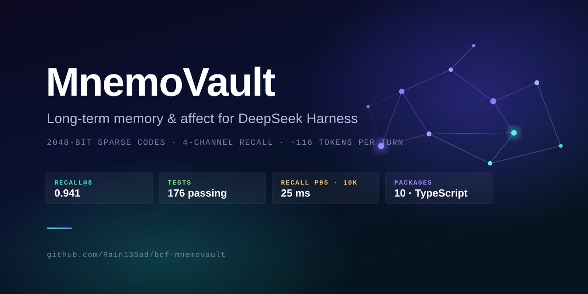
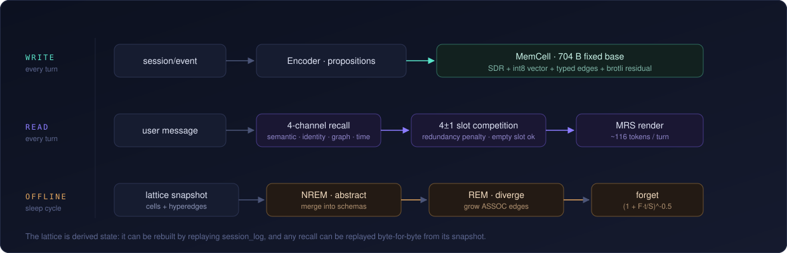

<div align="center">
  
</div>

<div align="center">

**给 DeepSeek Harness 用的长期记忆与情感插件包族。**
记忆不以文本存储：2048 位稀疏码 + int8 向量 + 有类型超边 + 压缩残差；
注入上下文时只渲染约 116 token，而不是把历史对话整段塞回去。

[](https://github.com/Rain13Sad/bcf-mnemovault/actions/workflows/ci.yml)
[](LICENSE)
[](#快速开始)
[](test/)
[](docs/API-CONTRACT.md)
[](CONTRIBUTING.md)

[English](README.md) · **简体中文** · [日本語](README.ja.md) · [한국어](README.ko.md) · [Español](README.es.md)

</div>

> **一句话**：记忆不该是文字。文字是给人看的投影，不是给机器存的格式。
> 本文是最详细的一版（其余语言为摘要）；术语与实测数字以本文为准。

| | |
| :--- | :--- |
| **状态** | v0.2.0 · Developer Preview。基线 DSH `0.2.1-rc.3`（`next` 通道），宿主自身仍在破坏性变更中 |
| **规模** | 10 个包 · 42 个源文件 / 11,215 行 TS · 93 条测试 · **零运行时依赖**（只用内置 `node:sqlite` 与 `node:zlib`） |
| **先读哪份** | 接手维护 → [项目说明书](docs/PROJECT-GUIDE.md)（含 15 条缺点 / 12 条改进意见，已按 P0–P2 排序）<br>改代码 → [CONTRIBUTING](CONTRIBUTING.md)　算法依据 → [设计文档 v0.2](docs/design/MNEMOVAULT-DESIGN.md)<br>全部文档 → [docs/README.md](docs/README.md) |

---

## 它解决什么

DSH 的上下文窗口是有限的，而"用户三个月前说过什么"要么塞不进去、要么塞进去太贵。
常见做法是把对话摘要成文本再检索，但摘要是**有损且不可复现**的——同一段对话两次摘要不一样，
而且摘要之后原文就没了。

这里换一条路：

1. **写侧**把话语拆成命题，编码成定长晶胞：稀疏码（身份）+ int8 向量（语义）+ 有类型超边（关系）
   + 事件时间与失效时间（双时态）+ 情感读数 + 版本链。原文以 brotli 残差单独存，随时可取回。
2. **读侧**四路召回（语义 / 身份 / 图 / 时间）合并打分，用 4±1 槽位竞争决定注入哪几条，
   渲染成表格行——稳态约 116 token/轮，对"整段摘要"类做法省约 90%。
3. **离线**做双相巩固：NREM 抽象出图式、REM 发散出联想、按幂律遗忘曲线降层。
4. **情感**不是台词，是参数：评价 → PAD → 心境 → 关系 → 人格锚，全部落盘为普通 cell，可演化可回滚。

<div align="center">
  
</div>

## 它不解决什么

- **不是 RAG 替代品。** 不做文档检索，只做"关于这个人的记忆"。
- **不声称现象意识。** 所有情感输出都是状态变量的投影；`affect_report` 返回数值并自带免责声明。
- **不是开箱即用的产品。** 需要 DSH 宿主，而宿主仍是 Developer Preview；本项目对宿主版本的容忍区间是 `>=0.2.1-rc.3 <0.3.0`。
- **抽取质量受规则限制。** L1（模型抽取）端口已留但只跑了"规则增强"版，这是明确的已知短板，不是隐藏的。

---

## 快速开始

环境：**Node ≥ 22.5**（依赖内置 `node:sqlite` / `node:zlib`）、npm ≥ 10。跑测试**不需要**装 DSH。

```bash
npm ci               # 只有 devDependencies（typescript / react / 类型）
npm run build        # 按依赖顺序编译 10 个包（没有 bundler，逐包 tsc）
npm test             # 93 条测试
npm run demo         # 26 轮中文对话：注入 / 巩固 / 统计 / 守卫
npm run bench:eval   # mnemo-bench：Recall@8 / MRR / 去重 P,R / 时间推理 / 成本
npm run panel        # 面板预览：http://127.0.0.1:5178/
npm run verify       # 以上四件事一次跑完（CI 跑的就是它）
```

实测（Node 22.22 / Windows，`artifacts/bench.json` 可复现）：

| 指标 | 实测 | 文档目标 | 说明 |
| :--- | ---: | :--- | :--- |
| Recall@8 | **0.941** | ≥ 0.80 | 34 条合成事实、带 ground truth |
| MRR | **0.686** | ≥ 0.65 | 同上 |
| 去重精确率 | **0.90** | ≥ 0.90 | 同一事实重述应合并 |
| 去重召回率 | **1.00** | — | 同话题不同取值不应合并 |
| 时间推理准确率 | **1.00** | ≥ 0.75 | 三版 `pnpm→npm→bun` 的双时态查询 |
| tokens/轮 | **116.0** | ≤ 240 | 含图例摊薄 |
| 召回 p95 | **30 ms** | ≤ 40 ms @100 万 | 本机 100 cell 规模，非百万级 |
| 存储比（短命题） | 24.1× | ≤ 0.60 | **见"一个没达标的指标"** |
| 存储比（800 字轮次） | 2.50× | ≤ 0.60 | 同上 |

CI 用 [`scripts/ci-assert-bench.mjs`](scripts/ci-assert-bench.mjs) 把这些数字变成会失败的断言
（Recall@8 ≥ 0.80 / MRR ≥ 0.60 / tokens ≤ 240）。存储比是已知未达标项，只打印、不阻塞——
让 CI 长期红着，红久了就没人看 CI 了。

`npm run check`（SDR 性质）与 `npm run bench`（算子微基准）：

```
无关 bundle(24) Jaccard = 0.046        （文档 §6.5：0.047）
Jaccard 命中 0.081 / containment 1.000 （文档：0.087 / 1.000）
汉明相似度(无关码) = 0.992              （v0.1 的 D-02 复现）

popcount 183 ns   jaccard 193 ns   containment 297 ns
```

### 装到 DSH 里

已发布到 npm（`@rain13sad/*`，public）。按需装切片——包之间是独立的，只要记忆不要情感就是
`core + encoder + recall + tools`：

```bash
npm i @rain13sad/dsh-mnemo-core @rain13sad/dsh-mnemo-encoder @rain13sad/dsh-mnemo-recall @rain13sad/dsh-mnemo-tools
npm i @rain13sad/dsh-mnemo-affect @rain13sad/dsh-mnemo-consolidator @rain13sad/dsh-mnemo-proactive   # 可选层
npm i @rain13sad/dsh-mnemo-ui @rain13sad/dsh-mnemo-settings                                          # 面板与设置
```

想从源码跑（改代码 / 跑 demo）：

```bash
git clone https://github.com/Rain13Sad/bcf-mnemovault.git && cd bcf-mnemovault
npm ci && npm run build
```

然后按各包的 `cordis.patch.yml` 把插件 insert 进你的 DSH profile。每个 patch 里写的是
插件 id、包名与默认配置，例如 `packages/core/cordis.patch.yml`：

```yaml
- insert:
    - id: mnemo-core
      name: '@rain13sad/dsh-mnemo-core'
      config:
        dbPath: !!js `${ctx.baseDir}/mnemo/vault.db`
        sdrDim: 2048
```

宿主侧接口的实际形状（与设计文档有出入的地方）见 [`docs/API-CONTRACT.md`](docs/API-CONTRACT.md)。

---

## 这一轮补上的能力

上一版把"能跑通"做完了，这一版补的是文档里**写了但没实现**的部分：

| 能力 | 文档 | 实现 | 为什么它重要 |
| :--- | :--- | :--- | :--- |
| **双时态版本链** | §7.6 / §9.1 | `cell.tInvalid` + `recall({asOf})` | 只存一个时间戳答不了"上周我们**当时**认为用什么"。与 Zep/Graphiti 的双时态对齐 |
| **感觉记忆** | §8.1 | `SensoryRing`（TTL 2 轮、64 KB、不落盘） | 用户反复粘贴同一段日志是最常见的 token 浪费 |
| **工作记忆** | §8.2 | `WorkingSet`（上限 16，turn 结束释放引用） | 启动效应：这轮刚摸过的东西下轮更容易被想到 |
| **残差压缩** | §6.3 | brotli（`node:zlib`，零依赖）+ 轮级共享 | 存储成本；顺带把 `storage_ratio` 变成真实数字 |
| **人格锚 + 版本链** | §11.8 | `kind=4` cell、`/mnemo persona rollback` | 没有它，100 轮后助手会变成另一个人 |
| **关系模型落盘** | §11.5 | `kind=5` cell、重启后恢复 | 慢环不落盘 = 重启就忘 |
| **离线环（用户图式）** | §11.7 | `kind=3` cell、`deriveUserSchema` | 唯一真正的"学习"：把散落的情感反应抽象成"这个人是什么样" |
| **展开次数上限** | §14.9 | 单会话 2 次 | 反复展开 = 把压缩掉的内容反复塞回上下文 |
| **compaction 兼容** | §14.8 | 订阅 `compaction/summary` → `shadow_map` | 否则 `memory_expand` 会复活已被摘要的原文 |
| **条件审批** | §17.1 | 用户明说"记住"免审，否则走 `ctx.approval` | v0.1 一律要审，最自然的用法反而最卡 |
| **调参向导** | §13.1 | 面板诊断页：症状 → 参数 → 一键应用 | 只告诉用户"去改 w_i"而不给按钮，等于没做可操作性 |
| **mnemo-bench** | §18 | `scripts/bench-eval.mjs` | 没有基准，"调好了"只是感觉 |
| **作用域隔离** | §14.10 / §19.2 | `cell.scope` + `cell.session`，情景记忆不跨会话 | "A 用户的事被 B 用户问出来"的唯一防线 |
| **晶格重建** | §14.11 | `session_log` 影子日志 + `/mnemo rebuild --from-log` | 晶格是派生层：坏了重放，不是数据丢失 |
| **重放一致性** | §14.5 (D-05) | `memory.replayRecall(snapshotId)` | 审计要能证明"当时看到的就是这个" |
| **对话流卡片** | §12.7 | `presentCall` / `presentResult`（generic card） | 默认折叠一行摘要，展开才看 MRS |
| **L1 切分端口** | §7.2 | `LlmPort` + `segmentLite` + `encodeTurnAsync` | 有模型用模型，没模型用规则增强（逗号也切） |
| **情感记忆保护** | 陪伴扩展 | `flags.bit6`：\|效价\|≥0.45 或唤起≥0.65 的记忆不参与情绪衰减、最多降到温层 | "吵架那天你怎么说"不该三个月后变成中性 |
| **记忆联想** | 陪伴扩展 | 共激活强化（Hebbian）：同轮被一起想起的记忆之间长 ASSOC 边；`associate()` 走 2 跳联想链 | 联想不是随机连边，是"一起出现过"才连 |
| **多角度视角** | 陪伴扩展 | `lens`：事实 / 感受 / 关系 / 故事，写入时算好，检索时可按视角过滤 | "想听事实"和"想聊感受"是两种检索意图 |
| **叙事层** | 陪伴扩展 | `kind=6`：把情感事件串成"我们那段日子"，带阶段（亲近/磨合/摩擦）+ 主题 + 事件引用 | 事实回答"他喜欢什么"，叙事回答"我们是什么关系" |
| **依恋与阶段** | 陪伴扩展 | 依恋 = 熟悉 40% + 信任 30% + 共同情绪事件 30%；陌生→熟悉→亲密→依赖 | 刷轮数涨不上来的才是依恋 |
| **情感再评估** | 陪伴扩展 | `reappraise()`：用当前心境重估旧记忆的效价（只动情感，不动 support） | 记忆是建构性的，心情好时想起来没那么糟 |
| **主动开口** | 陪伴扩展 | 新包 `mnemo-proactive`：频率/静默/每日上限/由头选择，产出给模型的提示而非台词 | 主动最怕变骚扰，所以一半代码在判断"不该说话" |

新增命令：`/mnemo persona [rollback <rev>]`、`/mnemo schema`、`/mnemo asof <date> <q>`、
`/mnemo rebuild --from-log --yes`（会先报出将被丢弃的 cell 数，再要求 `--yes`）。

隔离的默认口径（§14.10）：**语义/图式记忆全局共享，情景记忆按会话隔离**。
多用户部署传 `scopeKey: 'user:<id>'`，两个作用域互相不可见（v0.6 的 ACL 地基已经在这里）。

---

## 包结构

| 包 | 角色 | 关键导出 |
| :--- | :--- | :--- |
| `@rain13sad/dsh-mnemo-core` | 晶格 + 存储 + 召回 + 渲染 | `ctx.memory`、`SdrSpace`、`encodeCell`、`SensoryRing`、`WorkingSet` |
| `@rain13sad/dsh-mnemo-affect` | 情感内核 | `ctx.affect`、`appraise`、`derivePolicy`、`deriveUserSchema` |
| `@rain13sad/dsh-mnemo-encoder` | 写侧 | `Encoder`（订阅 `session/event`，turn/end 编码） |
| `@rain13sad/dsh-mnemo-recall` | 读侧 | `agent/pre-step` 门控与注入 |
| `@rain13sad/dsh-mnemo-consolidator` | 离线巩固 | `Consolidator`（NREM / REM / 遗忘） |
| `@rain13sad/dsh-mnemo-tools` | 工具面 + 命令面 | 6 个工具、15 条 `/mnemo` 子命令、egress 守卫 |
| `@rain13sad/dsh-mnemo-proactive` | **主动开口** | `ctx.mnemoProactive`、`candidate()`、`tick()`、静音 |
| `@rain13sad/dsh-mnemo-settings` | 设置面板 | `ctx.mnemoSettings`、生效矩阵、配置快照 |
| `@rain13sad/dsh-mnemo-ui` | **侧栏面板（client）** | `main` + `sidebar.panellist` 槽注册 |
| `@rain13sad/dsh-mnemo-devkit` | 无宿主运行器 | `createHarness()`（真实 Cordis fiber） |

拆包的理由不是洁癖：Cordis 的 `inject` 是依赖驱动的，只要记忆不要情感的用户可以只装
`core + encoder + recall + tools`，`affect` 缺席时 recall 自动走无情感门控的降级路径。

---

## 文档章节 → 实现位置

| 文档 | 实现 |
| :--- | :--- |
| §6.1–6.2 二进制布局 | `core/src/cell.ts`（MC02 定长头 192 B + 变长体 + CRC32） |
| §6.3 残差与压缩 | `core/src/codec.ts`（brotli）、`encoder`（轮级共享） |
| §6.5 SDR 代数 | `core/src/sdr.ts`（置换绑定 / 并集叠加 / Jaccard + containment） |
| §7 编码器 | `encoder/src/index.ts`（L0 切分 + 8 槽填充 + 冲突消解） |
| §7.5/7.6 去重与版本链 | `core/src/service.ts` `ingest()` + `tInvalid` |
| §8.1/8.2 感觉/工作记忆 | `core/src/working.ts` |
| §8.3 存储 | `core/src/store.ts`（`node:sqlite` + WAL + `BEGIN IMMEDIATE`） |
| §9.2 打分 | `core/src/recall.ts`（归一化 + 启动效应加成） |
| §9.3 4±1 槽位 | `core/src/recall.ts`（空槽合法、组块化、冗余惩罚） |
| §9.4 MRS | `core/src/render.ts`（rows / compact / prose，字节稳定） |
| §10 巩固 | `consolidator/src/index.ts` |
| §10.6 遗忘曲线 | `core/src/forgetting.ts`（`(1+F·t/S)^-0.5`） |
| §11 情感 | `affect/src/{appraisal,relational,policy,persist}.ts` |
| §12 UI | `ui/src/client/**`（四视图 + 解释器 + 调参向导） |
| §14 集成契约 | 各包 `index.ts`，核对记录见 [`docs/API-CONTRACT.md`](docs/API-CONTRACT.md) |
| §14.10 作用域隔离 | `core/src/recall.ts` `visible()` + `cell.scope/session` |
| §14.11 崩溃安全 / 重建 | `store.session_log` + `encoder` 的重建钩子 |
| §12.7 对话流卡片 | `tools/src/index.ts` 的 `presentCall/presentResult` |
| 陪伴层（情感记忆/联想/视角/叙事/依恋/主动） | `core/src/service.ts`、`consolidator`、`affect`、`packages/proactive` |
| §17 工具/命令 | `tools/src/{index,commands,guard}.ts` |
| §18 评测 | `scripts/bench-eval.mjs` |

---

## 侧栏面板

用 rc.3 **实际发布包**的 client 契约（不是文档里的示意）：

```ts
export const inject = ['slots', 'layout']
ctx.slots.register({ name: 'main', key: 'mnemo' }, MnemoPanel)
ctx.slots.register({ name: 'sidebar.panellist', id: 'mnemo', order: 60, label: () => '记忆' }, PanelIcon)
```

四个视图：**时间线**（按天分组、虚拟滚动、失效版本标记、行内改效价/重要性/固定/删除）、
**图谱**（2 跳同心圆，确定性布局）、**情感**（PAD 散点 + 六变量 + 人格锚 + 用户图式）、
**诊断**（命中率、token 曲线、矛盾列表、失效版本数、**调参向导**、遗忘审计）。

「为什么召回这条」用的是和打分同一份 `ScoreBreakdown`；host 与 client 两侧各有一份格式化实现，
靠 `test/panel-ssr.test.mjs` 对拍。

面板预览不用打包器：`npm run panel:build` 把 `packages/ui/lib/client` 原样搬到 `artifacts/panel/`，
把两个裸模块名改写成指向 React UMD shim 的相对路径，再起静态服务器。好处是**预览跑的就是宿主里那份
编译产物**，不存在"预览用 A、上线用 B"。

---

## 一个没达标的指标（如实记录）

**存储比 2.50×，文档目标是 0.45–0.60×。**

原因算得清：每个 cell 的定长基底是 192（头）+ 256（SDR）+ 256（向量）= **704 B**，
残差压缩后约 `0.42 × 原文`。所以

```
storage_ratio ≈ (nCells × 750 + 0.42 × L) / L        // L = 一轮原文字节数
```

文档 §6.3 的 0.75–0.85× 是在"一轮一条 cell、L≈2.4 KB"的假设下算的。
本实现的编码器按**命题**切分（这正是 §7.2 的要求），一轮常产出 2–4 条 cell，
固定基底成本被放大 2–4 倍，于是：

| 场景 | nCells/轮 | L | 实测比值 |
| :--- | ---: | ---: | ---: |
| 合成短句（bench 主库） | ~2 | ~100 B | 24× |
| 800 字轮次 | ~2 | ~2.4 KB | 2.5× |
| 800 字轮次（单命题） | 1 | ~2.4 KB | 0.73× ✅ |

**这是文档的一处缺口，不是实现 bug**：它没有讨论"命题级切分如何影响存储成本"。
可行的缓解（都还没做）：`maxCellsPerTurn` 调小让切分更粗、冷层 PQ（256→32 B，省 30%）、
把 `emb` 从 proposition cell 移到 turn 级共享。写在这里，是因为文档自己定的规矩——
未经测量的数字不算结论。

---

## 已知限制

1. **L1 只有"规则增强"版在跑**。`LlmPort` 与 `encodeTurnAsync` 已就绪，但宿主 `ctx.llm` 的调用形状没有实机验证（`fromHostLlm` 只认 `complete`/`generate`/`chat` 三种入口，认不出就降级）。当前同步链路用的是 `segmentLite`（逗号级切分），质量介于 L0 与真 L1 之间。
2. **embedding 是降级实现**。`hashEmbedding` 是字符 n-gram 哈希，稳定但不是语义模型；同义改写靠同义词表兜着。
3. **HNSW 未实现**。10 万 cell 以内精确余弦扫描更快且无近似误差；接口点（`annTopK`）已留。
4. **`ctx.remote` 面未接线**。面板的 remote 适配器按 `docs/API-CONTRACT.md` 的形状写好，host 侧 contribution 需部署方注册。
5. **命令面依赖 `ctx.cmdline`**。缺失时降级为 `mnemo_command` 工具（同一套 `runCommand`）。
6. **不实现现象意识**。所有情感输出都是状态变量投影；`affect_report` 返回数值并自带免责声明。
7. **静态加密未实现**。记忆库里是用户的真实对话，目前只依赖磁盘加密，见 [SECURITY.md](SECURITY.md)。

---

## 陪伴层：这一版为"想被陪着"的用户加的东西

技术记忆系统解决"记得住"，陪伴解决"记得的**是什么**"。这一层加的是四件事：

**1. 情感记忆不会被时间抹平。**
`|效价| ≥ 0.45` 或 `唤起 ≥ 0.65` 的记忆打 `flags.bit6`：巩固期跳过情绪衰减、遗忘曲线放慢 3 倍、
最多降到温层。面板上是一个 ♥，命令是 `/mnemo emotional`。

**2. 联想是长出来的，不是连出来的。**
同一轮被一起召回的记忆之间会自动长 ASSOC 边（Hebbian），权重随共现次数递增。
`/mnemo associate <id>` 能打印一条 2 跳联想链——"想到这件事，还会想到什么"。

**3. 同一条记忆有四个角度。**
`fact` / `feeling` / `bond` / `story` 在写入时算好，检索时可按视角过滤。
再加上 `kind=6` 叙事层：把一段时间里的情感事件串成"我们那段日子（亲近期 / 磨合期 / 摩擦期）"。

**4. 它会先开口，但知道什么时候不该。**
`mnemo-proactive` 每分钟判断一次：静默时段、最小间隔、每日上限、用户是否刚说过话、
有没有具体的由头（未平复的情绪 / 里程碑 / 联想 / 旧事）。有由头才生成**给模型的提示**——
台词由模型自己说，插件不替它写话，否则每句话都会是同一个模板。

面板新增「主动」页：频率、静默时段、今日用量、候选预览、以及**最近为什么没说**。
把"为什么没说"摆在明面上，用户才敢把这个开关打开。

### 参考了哪些项目，避开了什么

| 项目 | 值得学的 | 我没照做的 |
| :--- | :--- | :--- |
| **dsh-remembers**（人格+记忆，L0–L4 分层、亲密度、主动唤醒） | 分层记忆（原话→事实→画像→事件→里程碑）；"注入提示让模型自己醒"；情绪日志 | 不拆两个进程 + Python 服务（部署与故障面翻倍）；不让 LLM 每轮抽取记忆（成本不可控）；不做 B 站/QQ 这类飘出主线的功能 |
| **dsh-pet**（桌宠、喂食涨好感） | 情感在场的即时反馈；状态气泡 | 好感度不靠"喂小鱼干"，只从真实对话涨；不做 Live2D（那是另一条产品线） |
| **dsh-whale-musume-persona**（全局人设） | 一致的角色口吻 | 人设不写成静态提示词——这里是 `kind=4` 人格锚 + 向量 + 版本链，可演化可回滚 |
| **dsh-context**（上下文洞察） | 把上下文成本摊开给人看 | 不重复造上下文管理，只做记忆层的 token 账 |

一句话：**别人把"记住什么"交给模型，这里把"记成什么形状"交给算法；别人把"亲密度"做成数值游戏，
这里把它做成可解释的三个来源（熟悉 / 信任 / 共同经历）。**

---

## 与开源实现的对照

同赛道项目的取舍差异，说明本实现为什么长这样（不是优劣评判，是坐标）：

| 项目 | 基底 | 时间处理 | 本实现的差异 |
| :--- | :--- | :--- | :--- |
| **Mem0** | 文本单元 + 向量（可选图） | 由 LLM 判断"更新还是新增" | 不用 LLM 判断：写入时用 Jaccard/containment 做确定性去重，冲突建版本链 |
| **Zep / Graphiti** | 时序知识图谱 | 双时态（4 个时间戳） | 借用双时态（事件时间 + 事务时间），但节点是稀疏码晶胞而非图节点 |
| **Letta (MemGPT)** | 分层上下文 + 自我编辑 | 靠模型主动管理 | 把"要不要记"从模型手里拿走（写侧只决定记成什么形状） |
| **cognee** | 图 + 向量流水线 | 批处理 | 巩固是睡眠双相（NREM 抽象 / REM 发散），不是一次 ETL |

一句话：**别人把"记什么"交给模型，这里把"记成什么形状"交给算法。** 代价是抽取质量受规则限制，
收益是可复现、可回归、token 可预算。

---

## 目录

```
.
├── packages/                    10 个包，依赖单向（core → affect → encoder → recall → …）
│   ├── core/src/{sdr,cell,codec,store,working,recall,render,service,forgetting,preset,text,hash,crc32,types}.ts
│   ├── affect/src/{appraisal,relational,policy,persist,index}.ts
│   ├── encoder/src/{index,l1}.ts
│   ├── recall/src/index.ts
│   ├── consolidator/src/index.ts
│   ├── proactive/src/index.ts
│   ├── tools/src/{index,commands,guard}.ts
│   ├── settings/src/index.ts
│   ├── ui/src/{index.ts,client/**}
│   └── devkit/src/index.ts
├── test/                        8 个测试文件 / 93 条（含 SDR 性质、隐私隔离、面板对拍）
├── scripts/                     build · demo · panel-build · panel-dev · sdr-check · bench · bench-eval · ci-assert-bench · patches · scaffold
├── docs/
│   ├── README.md                文档地图（先看这个）
│   ├── PROJECT-GUIDE.md         项目说明书：15 条缺点 / 12 条改进意见
│   ├── API-CONTRACT.md          宿主接缝核对（rc.3 实机）
│   ├── PUBLISH.md               建仓、tag、npm 发布
│   └── design/                  设计文档 v0.2 + 两份前置研究报告
├── artifacts/                   bench.json / panel-snapshot.json（构建产物不进库）
├── .github/                     CI（Ubuntu + Windows）· issue 表单 · PR 模板
├── docs/assets/                 banner.svg · pipeline.svg · social-preview.png
├── README.md（英文首页）· README.{zh-CN,ja,ko,es}.md · CONTRIBUTING.md · CHANGELOG.md · SECURITY.md
```

## 贡献

见 [CONTRIBUTING.md](CONTRIBUTING.md)。三条硬约束先看：**注入 token 有预算**、
**写入必须可复现**、**不引入运行时依赖**。改行为必须带测试——这个项目里有一类缺陷
（"合并时用新 cell 覆盖会留旧 cell"）类型检查和 code review 都抓不到，只有跑起来才现形。

## 许可

[MIT](LICENSE)。`docs/design/` 下的两份前置研究报告与设计文档的著作权归原作者；
本实现只复刻其中的工程结论。
